# AI 팀 관제 (AI Team Console)

Claude, Codex, Gemini를 한 화면에서 부르고 지켜보는 내 PC용 관제 화면입니다.


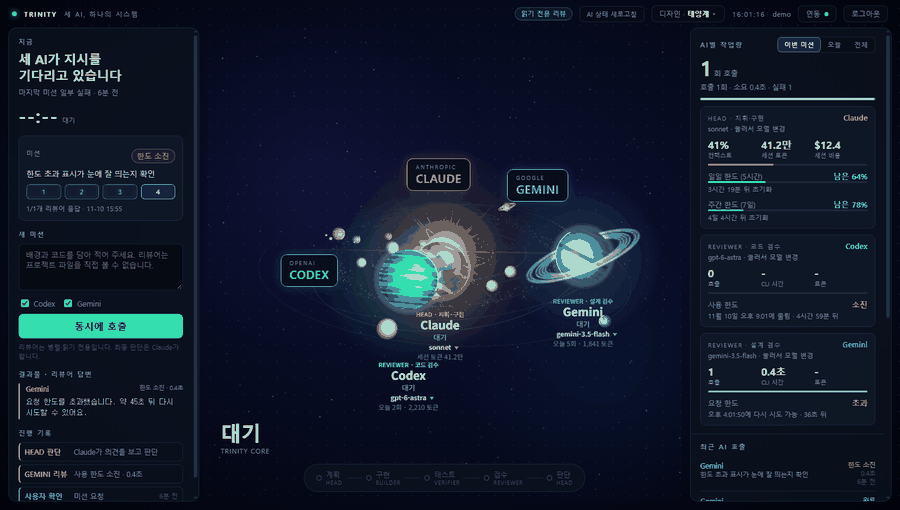

## 목차
1. [프로젝트 소개](#1-프로젝트-소개)
2. [주요 기능](#2-주요-기능)
3. [서비스 화면](#3-서비스-화면)
4. [WBS](#4-wbs)
5. [기능 명세서와 요구사항](#5-기능-명세서와-요구사항)
6. [기술 스택](#6-기술-스택)
7. [시스템 아키텍처와 유스케이스](#7-시스템-아키텍처와-유스케이스)
8. [데이터 저장 명세서](#8-데이터-저장-명세서)
9. [API 명세서](#9-api-명세서)
10. [리뷰어 호출과 한도 표시](#10-리뷰어-호출과-한도-표시)
11. [보안과 개인정보](#11-보안과-개인정보)
12. [테스트 결과](#12-테스트-결과)
13. [트러블슈팅](#13-트러블슈팅)
14. [향후 개선 계획](#14-향후-개선-계획)
15. [정리 자료](#15-정리-자료)
16. [실행 방법과 폴더 구조](#16-실행-방법과-폴더-구조)

---

## 1. 프로젝트 소개

AI 팀 관제는 Claude, Codex, Gemini를 한 화면에서 부르고 지켜보는 로컬 웹 앱입니다. Codex와 Gemini에게 같은 요청을 동시에 보내 코드와 설계 리뷰를 받고, AI별 호출 결과, 모델, 토큰, 남은 한도를 카드로 확인합니다. 호출 실패나 한도 소진은 관제실 화면에서 레이더 신호로 보여 주고, 화면은 태양계, 심해, 관제실 세 가지 디자인 중에 고를 수 있습니다.

Python 표준 라이브러리만으로 서버를 만들었고 화면은 Canvas 2D로 그렸습니다. 외부 패키지는 쓰지 않았습니다.

### 만들면서 신경 쓴 부분

- 리뷰어 호출: 리뷰어마다 스레드로 동시에 호출하고, Codex는 읽기 전용 샌드박스로 실행해 파일을 바꾸지 못하게 했습니다.
- 토큰 보호: 앱 로그인(PBKDF2 해시, 5회 실패 시 잠금)과 AI별 연동 두 겹으로 잠가서, 연결하지 않은 AI는 호출하지 않습니다. Gemini 키는 윈도우 DPAPI로 암호화해 저장합니다.
- 한도 표시: Codex 응답 문구, Gemini 429 응답, Claude 대화 기록에서 각각 남은 시간을 읽어 카드에 보여 줍니다.
- 설치·로그인 안내: PC마다 다른 설치 상태를 확인해서 다음에 할 일을 화면에 안내합니다.
- 자동 시험 60개가 통과합니다(로그인, AI 연동, 개인정보 점검 도구).

## 2. 주요 기능

### 사용 흐름

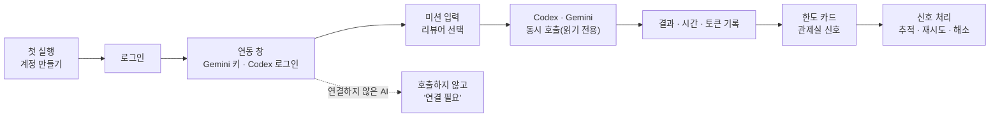

<details>
<summary><b>1. 리뷰어 병렬 호출</b></summary>

Codex(코드 리뷰)와 Gemini(설계 리뷰)에게 같은 요청을 동시에 보내고 답을 모아 봅니다. 리뷰어는 의견만 줄 수 있고 파일을 바꾸지는 못합니다.


</details>

<details>
<summary><b>2. AI별 모델 선택</b></summary>

AI를 눌러 모델을 고릅니다. Codex는 호출할 때만 쓰는 모델이고, Gemini는 모델 이름, Claude는 설정 파일의 `model` 항목을 바꿉니다.


</details>

<details>
<summary><b>3. 사용량과 한도</b></summary>

AI별 호출 횟수와 걸린 시간, 토큰을 보여 줍니다. Claude는 5시간과 7일 한도의 남은 비율과 초기화까지 남은 시간, Codex는 한도가 풀리는 시각, Gemini는 429가 났을 때 재시도 가능한 시각을 카드에 표시합니다.


</details>

<details>
<summary><b>4. 관제실 이상 신호 처리</b></summary>

호출 실패, 한도, 연결 끊김을 레이더 신호로 보여 줍니다. 신호를 눌러 추적, 식별, 보류, 재시도, 해소를 고르고, 정상 신호는 통과시킵니다.


</details>

<details>
<summary><b>5. 로그인과 AI 연동</b></summary>

첫 실행에서 계정을 만들어야 화면이 열립니다. 상단 연동 창에서 Gemini 키와 Codex 로그인을 직접 연결해야 그 AI를 호출할 수 있고, 설치와 로그인 상태가 단계별로 안내됩니다.

 
</details>

<details>
<summary><b>6. 앱처럼 실행</b></summary>

바로가기를 더블클릭하면 주소창 없는 앱 창으로 열리고, 창을 닫으면 서버도 곧 꺼집니다.
</details>

## 3. 서비스 화면

### 세 가지 디자인
상단의 디자인 드롭다운에서 고릅니다. 태양계는 세 AI가 행성이 되어 태양 둘레를 돌고, 작업 중이면 행성이 빨라집니다. 심해는 입자로 그린 해파리, 가오리, 고래가 헤엄칩니다. 관제실은 레트로 레이더 화면입니다.

  

### 로그인과 AI 연동
첫 실행에서는 계정 만들기가 나옵니다. 연동 창에서 Gemini 키를 붙여넣고 Codex는 로그인 버튼으로 로그인하며, 연결하지 않은 AI는 카드에 "연결 안 됨"이 뜨고 리뷰어 체크칸이 꺼집니다. 아래는 아직 아무것도 연결하지 않은 상태입니다.

 

## 4. WBS

[07_WBS.xlsx](deliverables/07_WBS.xlsx)

<details>
<summary><b>WBS</b></summary>

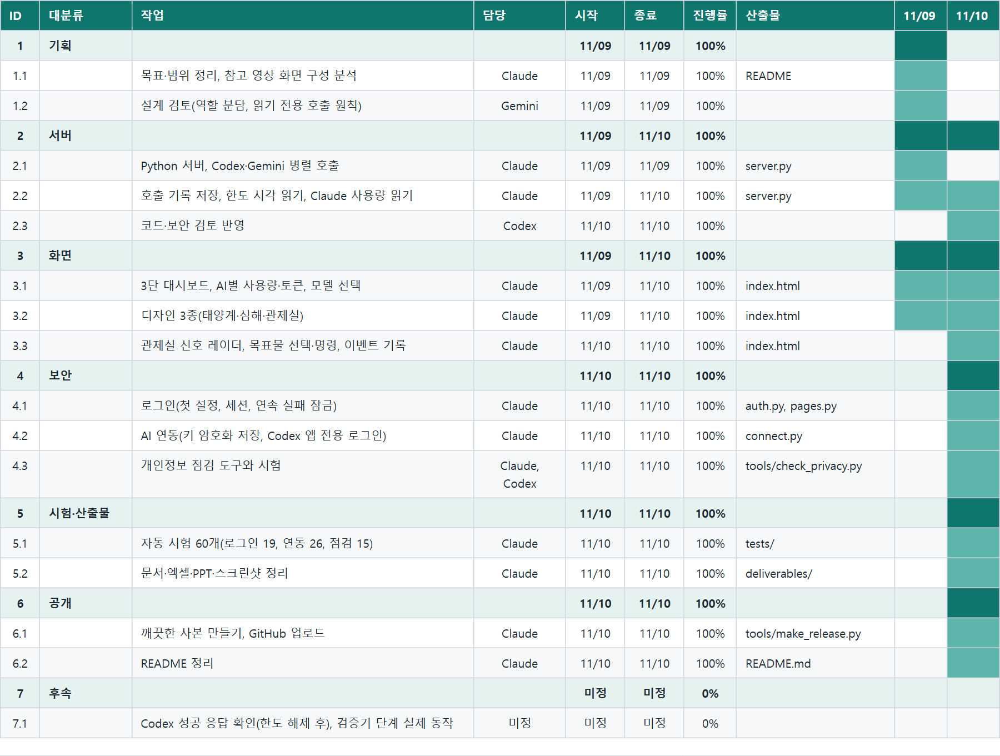

</details>

## 5. 기능 명세서와 요구사항

[08_요구사항_명세서.xlsx](deliverables/08_요구사항_명세서.xlsx) · [09_기능_명세서_목록.xlsx](deliverables/09_기능_명세서_목록.xlsx)

<details>
<summary><b>기능 명세서</b></summary>

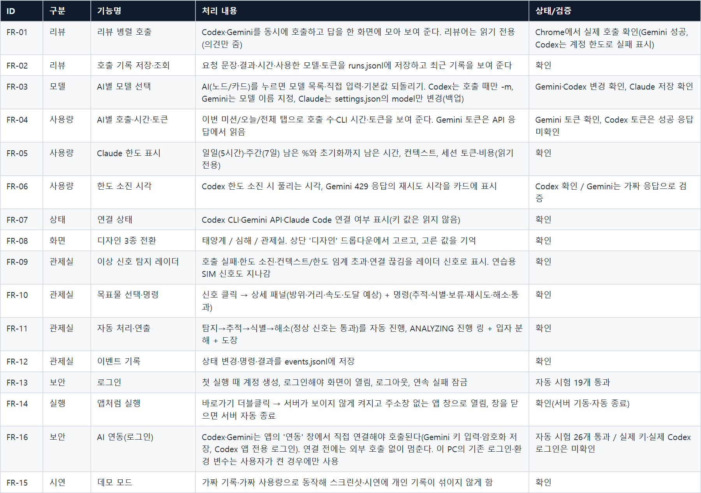

</details>

<details>
<summary><b>기능 요구사항</b></summary>

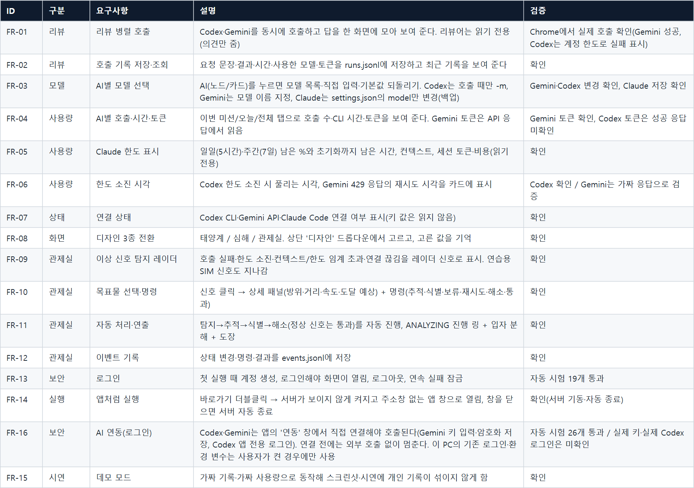

</details>

<details>
<summary><b>비기능 요구사항</b></summary>

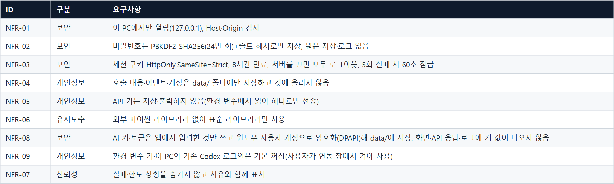

</details>

## 6. 기술 스택

### 서버


### 화면


### AI 연결


### 보안·실행


개발은 Windows 10에서 했고, 화면 확인은 헤드리스 Chrome으로 했습니다.

## 7. 시스템 아키텍처와 유스케이스

### 유스케이스


### 시스템 아키텍처

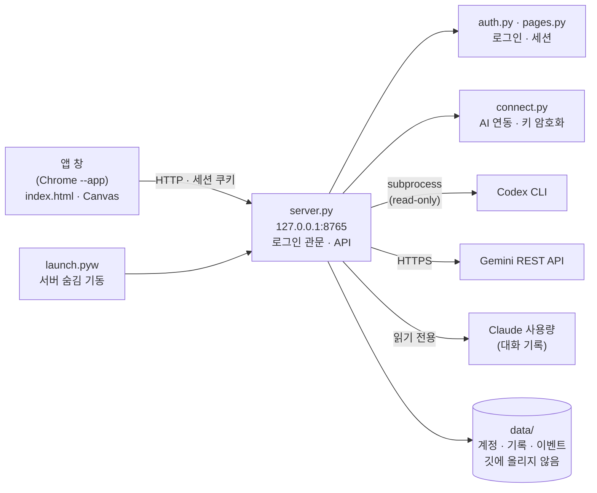

서버는 파이썬 표준 라이브러리의 `http.server`만 씁니다. 화면(`index.html`)은 외부 라이브러리 없이 Canvas 2D로 그리고, 관제실 쪽 코드는 Events, Targets, Commands, Panel, HUD 모듈로 나눴습니다. 구성도 PDF는 [12_시스템·서비스_구성도.pdf](deliverables/12_시스템·서비스_구성도.pdf), 유스케이스는 [10_유스케이스_다이어그램.pdf](deliverables/10_유스케이스_다이어그램.pdf)입니다.

## 8. 데이터 저장 명세서

[14_데이터_저장파일_명세서.xlsx](deliverables/14_데이터_저장파일_명세서.xlsx)

<details>
<summary><b>데이터 저장 파일 명세</b></summary>

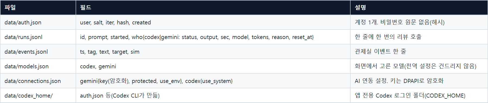

</details>

## 9. API 명세서

[15_API_명세서.xlsx](deliverables/15_API_명세서.xlsx)

<details>
<summary><b>API 명세</b></summary>

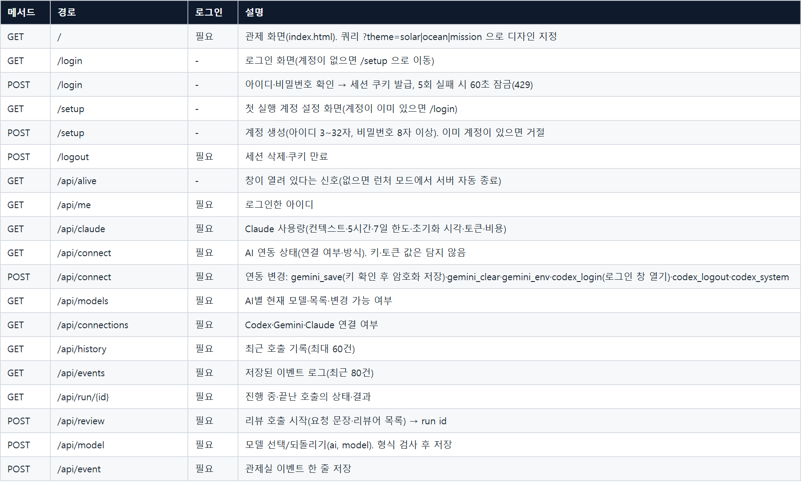

</details>

## 10. 리뷰어 호출과 한도 표시

### 리뷰어 호출

리뷰 요청이 오면 리뷰어마다 스레드를 하나씩 띄워서 동시에 부릅니다. 가장 느린 리뷰어 시간만큼만 기다리면 됩니다.

```python
def start_run(prompt, who_list):
    run_id = uuid.uuid4().hex[:8]
    STATE[run_id] = {"prompt": prompt, "started": time.strftime("%Y-%m-%d %H:%M:%S"),
                     "who": {w: {"status": "wait", "output": "", "sec": 0} for w in who_list}}
    for w in who_list:  # 동시에(병렬로) 호출
        threading.Thread(target=run_one, args=(run_id, w), daemon=True).start()
    return run_id
```

Codex는 `codex exec --sandbox read-only`로 부릅니다. 읽기 전용 샌드박스라서 리뷰 도중에 프로젝트 파일을 바꾸지 못하고, Gemini는 REST로 답만 받아 옵니다. 결과, 걸린 시간, 모델, 토큰은 `data/runs.jsonl`에 한 줄씩 쌓입니다.

### 한도와 사용량

한도 표시는 AI마다 구하는 방법이 달랐습니다.

Codex는 한도가 다 되면 응답 문구에 풀리는 날짜와 시각이 영어로 들어 있어서, 마지막 호출이 한도 응답이면 그 시각을 읽어 카드에 보여 줍니다. Gemini는 429 응답의 `RetryInfo`, "retry in Ns" 문구, `Retry-After` 헤더에서 재시도 가능한 시각을 읽습니다. 실제 Gemini 429 응답은 아직 받아 보지 못해서 이 부분은 가짜 응답으로만 확인했습니다.

Claude는 서버에 물어보지 않습니다. 처음에는 이 PC에서 돌아가는 사용량 표시 도구가 쓰는 파일(`hamster-state.json`)을 읽었는데, 그러면 다른 PC에서는 아무것도 안 보였습니다. 그래서 그 파일이 없으면 Claude Code가 남기는 대화 기록(`~/.claude/projects`)에서 최근 5시간과 7일 동안 쓴 토큰을 직접 세고, 초기화 시각은 5시간 구간의 첫 메시지 시각에 5시간을 더해 추정합니다. 이 PC에서는 추정한 시각이 원래 값과 몇 분 차이였습니다. 다만 한도의 퍼센트와 비용은 서비스 쪽 값이라 기록으로는 알 수 없어서, 그런 PC에서는 토큰 수와 추정 시각만 보여 줍니다.

## 11. 보안과 개인정보

이 앱이 내 PC에서 돌아가니까, 누군가 이 앱을 열면 내 Codex나 Gemini 토큰으로 호출할 수 있게 됩니다. 이걸 막으려고 두 겹으로 잠갔습니다.

먼저 앱 로그인입니다. 첫 실행에서 정한 아이디와 비밀번호가 있어야 화면이 열립니다. 비밀번호는 PBKDF2-SHA256(24만 번)과 솔트로 해시해서만 저장하고, 비교는 `hmac.compare_digest`로 합니다. 5번 틀리면 60초 동안 잠기고, 세션 쿠키는 `HttpOnly`와 `SameSite=Strict`에 8시간 만료입니다. 서버는 `127.0.0.1`에서만 듣고, Host와 Origin을 검사해서 다른 사이트에서 날아온 요청은 거절합니다.

그다음은 AI별 연동입니다. 로그인했더라도 연동 창에서 직접 연결하지 않은 AI는 외부 서비스를 부르지 않고 "연결 필요"로 바로 끝납니다. 환경 변수에 키가 있거나 이 PC에 이미 Codex 로그인이 있어도 기본으로는 쓰지 않고, 연동 창에서 켜야 합니다.

- Gemini 키는 저장하기 전에 Google에 한 번 물어서 쓸 수 있는 키인지 확인합니다. 그다음 윈도우 DPAPI로 암호화해서 `data/connections.json`에 저장합니다. 이 PC의 이 사용자 계정만 풀 수 있고, 화면, API 응답, 로그 어디에도 키가 나오지 않습니다. 윈도우가 아니면 암호화를 쓸 수 없어서 파일 권한으로만 보호하고 화면에 경고를 띄웁니다.
- Codex는 이 앱 전용 로그인 폴더(`CODEX_HOME`)를 따로 씁니다. 연동 창의 로그인 버튼이 새 터미널 창으로 `codex login`을 열어 줍니다.

```python
return hashlib.pbkdf2_hmac("sha256", password.encode("utf-8"), salt, iters)
...
fn = crypt32.CryptProtectData if protect else crypt32.CryptUnprotectData   # Windows DPAPI
```

연동 창은 이 PC에 Claude Code, Codex CLI가 설치돼 있는지와 로그인돼 있는지도 확인합니다. 없으면 설치 명령을 복사할 수 있게 보여 주고, 로그인 버튼으로 창을 열어 줍니다. 사람마다 PC 환경이 다르니까 "안 된다"에서 끝나지 않고 다음에 뭘 해야 하는지가 화면에 나와야 한다고 생각했습니다.

저장소에 올리기 전에는 `python -I tools/check_privacy.py . --tracked`로 개인 경로, 이메일, 키 모양의 문자열, 기록 파일이 섞이지 않았는지 검사하고, `python -I tools/make_release.py`로 허용 목록에 있는 파일만 복사한 깨끗한 사본을 만듭니다. 이 저장소도 그 사본에서 올렸습니다. 점검 결과는 [26_보안·개인정보_점검.pdf](deliverables/26_보안·개인정보_점검.pdf)에 정리했습니다.

## 12. 테스트 결과

```bash
python -I tests/test_auth.py       # 로그인 19개
python -I tests/test_connect.py    # AI 연동 26개
python -I tests/test_privacy.py    # 개인정보 점검 도구 15개
```

시험은 임시 폴더와 다른 포트에 따로 띄운 서버에서 돌아서 내 실제 계정, 키, 외부 서비스를 건드리지 않습니다. 세 파일 합쳐서 60개이고 지금은 전부 통과합니다.

- 로그인 19개: 계정 만들기, 로그인, 잠금, 세션, 다른 사이트의 요청 거절
- AI 연동 26개: 연결하지 않으면 5초 안에 외부 호출 없이 실패하는지, 키 형식 검사, 저장 파일에 평문 키가 없는지, 응답과 상태에 키가 없는지, 연결을 해제하면 키가 사라지는지, 환경 변수의 키를 몰래 쓰지 않는지
- 개인정보 점검 도구 15개: 깨끗한 폴더는 통과하고, `data` 폴더, `auth.json`, 호출 기록, 바로가기, 내 PC 경로, 이메일, 키 모양이 든 폴더는 실패하는지

[19_테스트·검증_결과.xlsx](deliverables/19_테스트·검증_결과.xlsx)

<details>
<summary><b>자동 시험</b></summary>

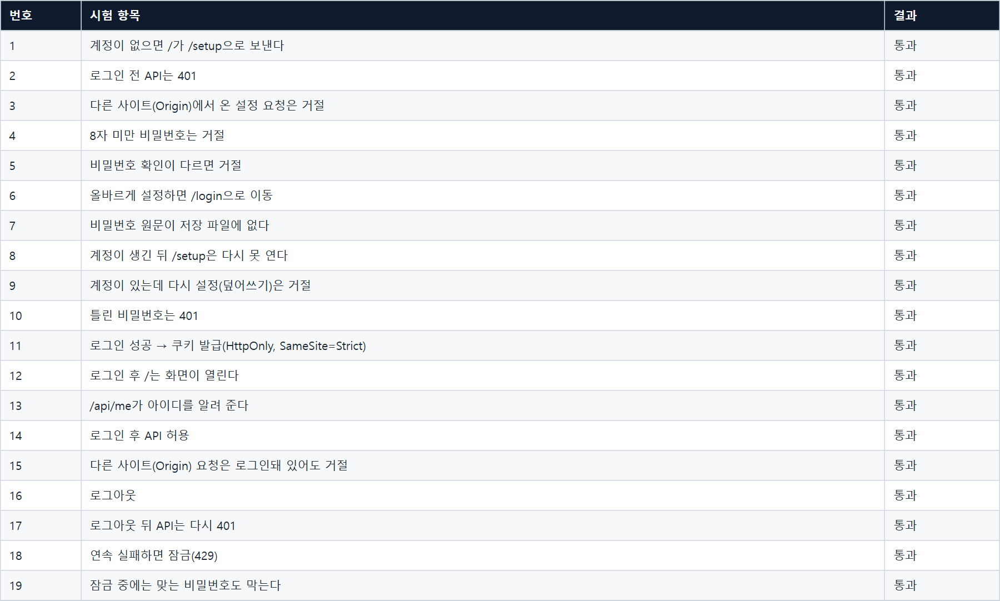

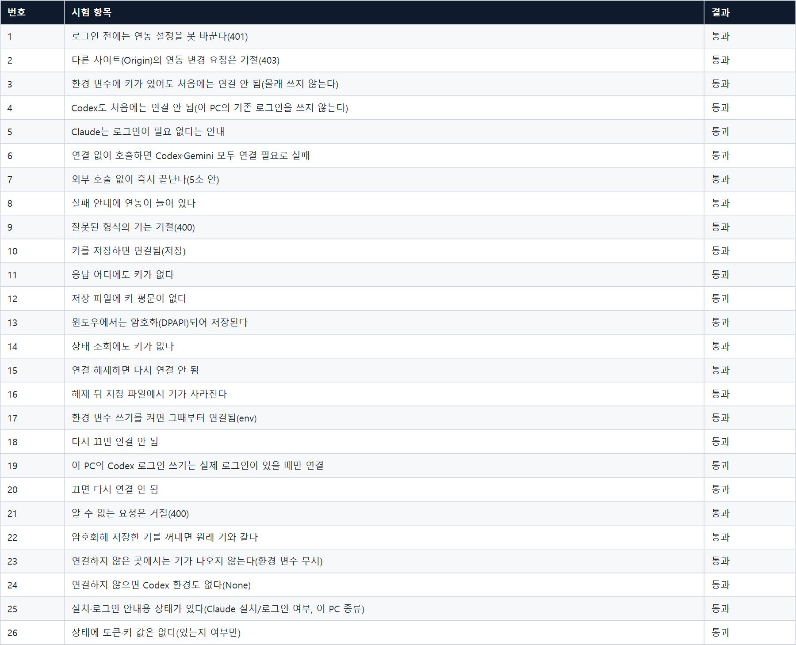

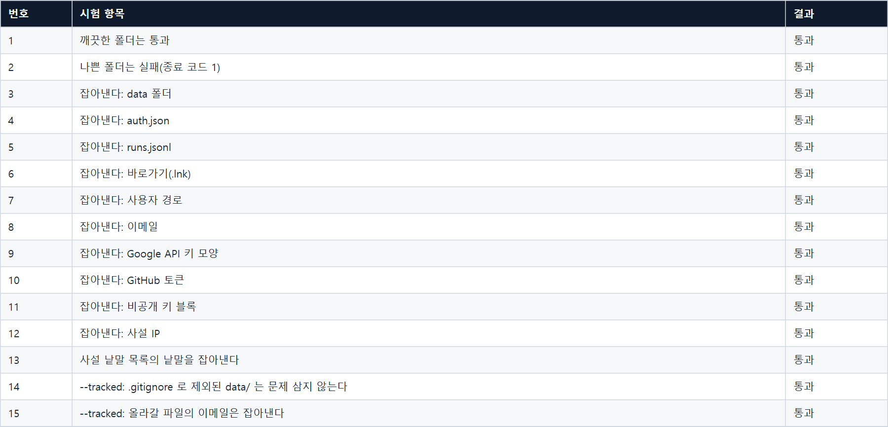

</details>

<details>
<summary><b>화면에서 직접 확인한 항목</b></summary>

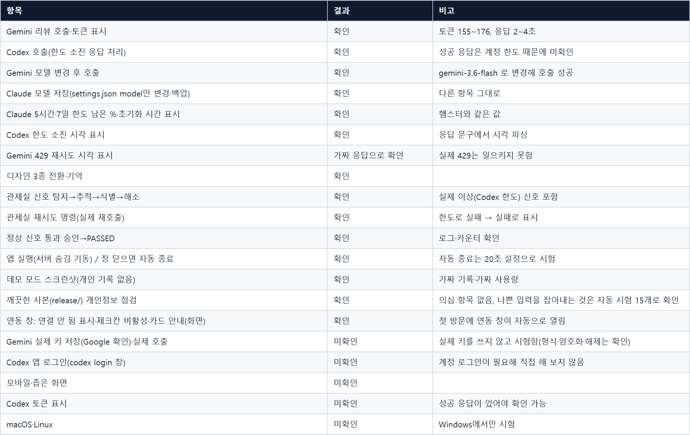

</details>

## 13. 트러블슈팅

<details>
<summary><b>1. 계정 만들기를 누르면 흰 화면에 {}만 떴습니다</b></summary>

1.1 문제 상황<br>
첫 설정 화면에서 계정 만들기를 누르면 흰 화면에 `{}`만 보이고 계정이 만들어지지 않았습니다.

1.2 원인<br>
서버가 `Referrer-Policy: no-referrer`를 보내서 크롬이 폼 전송에 `Origin: null`을 붙였습니다. 제가 넣어 둔 보안 검사가 그 요청을 다른 사이트에서 온 것으로 보고 거절한 것이었습니다.

1.3 해결<br>
헤더를 `same-origin`으로 바꿨습니다. 같은 주소에서 보낸 요청에는 진짜 주소가 붙고, 다른 사이트로는 여전히 아무 정보도 나가지 않습니다. 보안 검사는 그대로 뒀습니다.
</details>

<details>
<summary><b>2. python -I로 실행하면 로그인 모듈을 찾지 못했습니다</b></summary>

2.1 문제 상황<br>
`python -I server.py`로 띄우면 `auth`, `pages` 모듈을 가져오지 못했습니다.

2.2 원인<br>
격리 모드(`-I`)는 스크립트가 있는 폴더를 import 경로에 넣지 않습니다.

2.3 해결<br>
서버가 시작할 때 자기 폴더를 경로에 직접 추가합니다.
</details>

<details>
<summary><b>3. 환경 변수의 키가 연동 없이도 쓰일 수 있었습니다</b></summary>

3.1 문제 상황<br>
환경 변수에 `GEMINI_API_KEY`가 있으면 연동 창에서 연결하지 않아도 Gemini가 호출됐습니다.

3.2 원인<br>
처음에는 편하게 환경 변수를 그대로 읽었습니다. 그런데 이러면 이 앱을 여는 누구나 내 키로 호출할 수 있습니다.

3.3 해결<br>
환경 변수와 이 PC의 기존 Codex 로그인은 기본 꺼짐으로 바꾸고, 연동 창에서 직접 켜야만 쓰이게 했습니다. 연결 없이 호출하면 외부 서비스를 부르지 않고 바로 실패하는지는 시험으로 확인합니다.
</details>

<details>
<summary><b>4. 다른 PC에서는 Claude 사용량이 안 보였습니다</b></summary>

4.1 문제 상황<br>
사용량 카드가 이 PC에서는 나오는데 다른 PC에서는 비어 있었습니다.

4.2 원인<br>
이 PC에서만 돌아가는 사용량 표시 도구의 파일을 읽고 있었습니다.

4.3 해결<br>
그 파일이 없으면 Claude Code의 대화 기록에서 토큰을 직접 세도록 했습니다. 대신 한도 퍼센트와 비용은 서비스 쪽 값이라 알 수 없어서, 그런 PC에서는 토큰 수와 추정 초기화 시각만 보여 줍니다.
</details>

<details>
<summary><b>5. 설치되지 않은 PC에서는 어떻게 해야 하는지 알 수 없었습니다</b></summary>

5.1 문제 상황<br>
Codex CLI나 Claude Code가 없는 PC에서 연동 창을 열어도 무엇을 해야 하는지 안내가 없었습니다.

5.2 해결<br>
연동 창이 설치와 로그인 여부를 확인해서 단계별로 안내합니다. 설치 명령은 복사할 수 있게 보여 주고, 로그인 버튼은 새 터미널 창으로 해당 명령을 열어 줍니다. 맥과 리눅스처럼 창을 자동으로 열 수 없는 환경에서는 명령을 직접 실행하라는 안내가 뜹니다.
</details>

<details>
<summary><b>6. 다른 창에 가려진 앱 창이 거의 멈췄습니다</b></summary>

6.1 문제 상황<br>
화면 촬영이 계속 시간 초과가 났고, 애니메이션이 1초에 한 장쯤으로 느려 보였습니다.

6.2 원인<br>
다른 창에 가려진 창은 브라우저가 그리기 속도를 크게 줄입니다.

6.3 해결<br>
확인용 화면은 헤드리스 Chrome으로 찍습니다.
</details>

## 14. 향후 개선 계획

### 1. 리뷰어 호출 안정화

- 현재: 한도가 다 되면 실패로 표시하고 풀리는 시각만 알려 줍니다. 풀린 뒤 다시 보내는 건 직접 해야 합니다.
- 개선: 풀리는 시각까지 요청을 대기열에 두었다가 자동으로 재시도합니다. 한쪽 리뷰어가 막혔을 때 나머지 리뷰어 답만으로 먼저 결과를 보여 주는 동작도 추가합니다.

### 2. 리뷰어 추가가 쉬운 구조

- 현재: Codex와 Gemini 호출 코드가 `server.py`에 각각 들어 있습니다.
- 개선: 호출부를 어댑터 형태로 분리해서, 설정만 추가하면 다른 AI나 로컬 모델(Ollama 등)을 리뷰어로 붙일 수 있게 합니다. 연동 창과 사용량 카드도 어댑터 목록을 읽어 자동으로 만들어지게 합니다.

### 3. 리뷰 결과 비교 요약

- 현재: 리뷰어별 답을 나란히 보여 주기만 합니다.
- 개선: 두 답에서 의견이 일치하는 항목과 엇갈리는 항목을 뽑아 한 번에 정리해서 보여 줍니다. 엇갈리는 항목은 미션 기록에 남겨 나중에 어느 쪽이 맞았는지 표시할 수 있게 합니다.

### 4. 사용량 통계와 알림

- 현재: 이번 미션, 오늘, 전체 기준의 호출 수와 토큰을 숫자로 보여 줍니다.
- 개선: 일·주 단위 추이 그래프와 AI별 비교 화면을 추가하고, 한도에 가까워지면 데스크톱 알림을 보냅니다. 임계값은 사용자가 직접 정할 수 있게 합니다.

### 5. 기록 저장소

- 현재: 호출과 이벤트 기록을 `runs.jsonl`, `events.jsonl`에 한 줄씩 이어 씁니다.
- 개선: SQLite로 옮겨서 기간·AI·성공 여부로 검색하고, 오래된 기록은 정리할 수 있게 합니다. 기존 jsonl은 처음 실행할 때 가져옵니다.

### 6. 관제실 신호 규칙 설정

- 현재: 신호를 띄우는 기준(컨텍스트와 한도 임계 등)이 코드에 고정되어 있습니다.
- 개선: 기준값을 설정 화면에서 바꾸고, 신호별 자동 처리 방식(추적, 재시도, 통과)을 고를 수 있게 합니다.

### 7. 다른 운영체제 지원

- 현재: Gemini 키 암호화에 윈도우 DPAPI를 써서 윈도우에서만 키를 저장할 수 있습니다.
- 개선: macOS 키체인과 Linux Secret Service를 저장 방식으로 추가하고, 플랫폼별로 맞는 방식을 자동으로 고르게 합니다.

### 8. 설치 방식

- 현재: Python과 Chrome이 있어야 하고 `launch.pyw`로 실행합니다.
- 개선: PyInstaller로 실행 파일을 만들고 시스템 트레이에 상주시킵니다. 새 버전 확인과 업데이트도 붙입니다.

## 15. 정리 자료

[PDF](deliverables/AI관제_발표자료_디자인판.pdf) · [PPT](deliverables/AI관제_발표자료_디자인판.pptx)

   

## 16. 실행 방법과 폴더 구조

Python 3.10 이상과 Chrome 또는 Edge가 있으면 됩니다. 설치할 패키지는 없습니다.

```bash
python launch.pyw          # 서버를 숨겨서 켜고 앱 창으로 엽니다 (창을 닫으면 서버도 곧 꺼집니다)
python -I server.py        # 서버만 켜려면, 브라우저에서 http://127.0.0.1:8765
```

처음 열면 계정 만들기 화면이 나옵니다. 아이디(3~32자)와 비밀번호(8자 이상)를 정하면 되고 기본 계정은 없습니다. 비밀번호를 잊으면 `data/auth.json`을 지우고 다시 정하면 됩니다. 그다음 상단 연동에서 Gemini 키를 붙여넣고, Codex는 로그인 버튼으로 로그인합니다. 연동 없이도 화면은 열리고 연결 안 된 AI는 "연결 안 됨"으로 표시됩니다.

```
server.py        서버, 호출·기록·API, 로그인 관문
auth.py          로그인(PBKDF2, 세션, 잠금)
pages.py         로그인·첫 설정 화면
connect.py       AI 연동(키 암호화 저장, Codex 앱 전용 로그인)
index.html       관제 화면(Canvas 2D)
launch.pyw       앱처럼 실행(서버 숨김 기동 + 앱 창)
tests/           자동 시험
tools/           데모 데이터, 스크린샷, 개인정보 점검, 깨끗한 사본, 산출물 생성
deliverables/    산출물(PDF·엑셀), 발표 PPT, 스크린샷
docs/            업로드 계획, WBS, README용 그림
```
