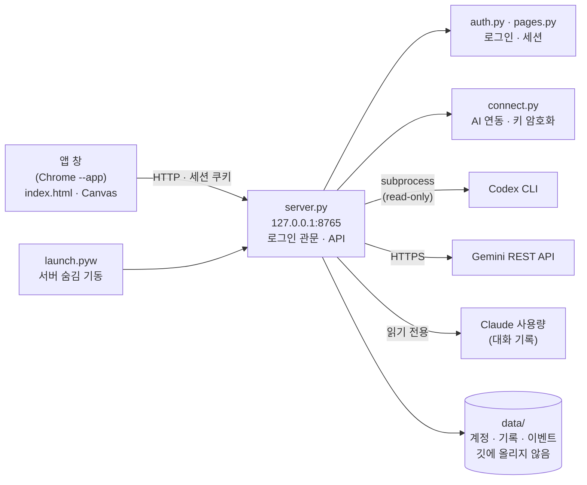

# AI 팀 관제 (AI Team Console)

Claude, Codex, Gemini를 한 화면에서 부르고 지켜보는 내 PC용 관제 화면입니다. 혼자 만든 개인 프로젝트이고 2026년 11월 9일부터 10일까지 만들었습니다.


 

화면은 전부 가짜(데모) 데이터로 찍었습니다. 계정, 키, 호출 기록은 `data/` 폴더에만 저장하고 깃에는 올리지 않습니다. 발표 자료는 [PDF](deliverables/AI관제_발표자료_디자인판.pdf)로 올려 두었습니다.

## 목차
- [만든 이유](#만든-이유)
- [기능](#기능)
- [리뷰어 호출](#리뷰어-호출)
- [내 토큰을 지키는 방법](#내-토큰을-지키는-방법)
- [한도와 사용량](#한도와-사용량)
- [구조](#구조)
- [데이터](#데이터)
- [화면](#화면)
- [테스트](#테스트)
- [실행 방법](#실행-방법)
- [폴더 구조](#폴더-구조)
- [개발하면서 막혔던 것](#개발하면서-막혔던-것)
- [아직 못 한 것](#아직-못-한-것)
- [참고](#참고)

## 만든 이유

AI를 하나만 쓰지 않고 역할을 나눠 쓰고 있습니다. Claude가 구현을 맡고, 설계 검토는 Gemini에게, 코드와 보안 검토는 Codex에게 읽기 전용으로 맡깁니다. 이렇게 쓰다 보니 창이 세 개로 나뉘어서 지금 누가 뭘 하는지, 한도가 얼마나 남았는지 한눈에 보이지 않았습니다. 한도가 다 되면 호출이 그냥 실패하는데, 왜 실패했고 언제 풀리는지를 매번 따로 찾아야 했습니다.

그래서 호출과 결과, 모델, 토큰, 한도를 한 화면에 모으기로 했습니다. 화면 배치는 유튜브 '디렉터스AI'의 "AI DEV DIRECTOR" 영상에서 본 3단 구성(왼쪽 미션, 가운데 단계, 오른쪽 AI 현황)을 참고했고, 코드는 영상과 상관없이 직접 썼습니다.

처음에는 영상 화면을 따라 만들다가 한도가 다 차서 멈췄고, 나중에 AI별 토큰 표시와 모델 변경까지 다시 만들어서 마무리했습니다. 디자인은 입자 우주에서 시작해 심해를 거쳐 지금의 태양계, 심해, 관제실 세 가지가 됐고, 상단 드롭다운에서 고릅니다. 연동 창은 "내가 연결하지 않은 AI는 호출되면 안 된다"는 생각에서 나중에 넣었습니다.

## 기능

- Codex(코드 리뷰)와 Gemini(설계 리뷰)에게 같은 요청을 동시에 보내고 답을 모아 봅니다. 리뷰어는 의견만 줄 수 있고 파일을 바꾸지는 못합니다.
- AI를 눌러 모델을 고릅니다. Codex는 호출할 때만 쓰는 모델이고, Gemini는 모델 이름, Claude는 설정 파일의 `model` 항목을 바꿉니다.
- AI별 호출 횟수와 걸린 시간, 토큰을 보여 줍니다. Claude는 5시간과 7일 한도의 남은 비율과 초기화까지 남은 시간, Codex는 한도가 풀리는 시각, Gemini는 429가 났을 때 재시도 가능한 시각을 카드에 표시합니다.
- 관제실 디자인에서는 호출 실패, 한도, 연결 끊김을 레이더 신호로 보여 줍니다. 신호를 눌러 추적, 식별, 보류, 재시도, 해소를 고르고, 정상 신호는 통과시킵니다.
- 첫 실행에서 계정을 만들어야 화면이 열립니다. 상단 연동 창에서 Gemini 키와 Codex 로그인을 직접 연결해야 그 AI를 호출할 수 있습니다.
- 바로가기를 더블클릭하면 주소창 없는 앱 창으로 열리고, 창을 닫으면 서버도 곧 꺼집니다.

## 리뷰어 호출

리뷰 요청이 오면 리뷰어마다 스레드를 하나씩 띄워서 동시에 부릅니다. 가장 느린 리뷰어 시간만큼만 기다리면 됩니다.

```python
def start_run(prompt, who_list):
    run_id = uuid.uuid4().hex[:8]
    STATE[run_id] = {"prompt": prompt, "started": time.strftime("%Y-%m-%d %H:%M:%S"),
                     "who": {w: {"status": "wait", "output": "", "sec": 0} for w in who_list}}
    for w in who_list:  # 동시에(병렬로) 호출
        threading.Thread(target=run_one, args=(run_id, w), daemon=True).start()
    return run_id
```

Codex는 `codex exec --sandbox read-only`로 부릅니다. 읽기 전용 샌드박스라서 리뷰 도중에 프로젝트 파일을 바꾸지 못하고, Gemini는 REST로 답만 받아 옵니다. 결과, 걸린 시간, 모델, 토큰은 `data/runs.jsonl`에 한 줄씩 쌓입니다.

## 내 토큰을 지키는 방법

이 앱이 내 PC에서 돌아가니까, 누군가 이 앱을 열면 내 Codex나 Gemini 토큰으로 호출할 수 있게 됩니다. 이걸 막으려고 두 겹으로 잠갔습니다.

먼저 앱 로그인입니다. 첫 실행에서 정한 아이디와 비밀번호가 있어야 화면이 열립니다. 비밀번호는 PBKDF2-SHA256(24만 번)과 솔트로 해시해서만 저장하고, 비교는 `hmac.compare_digest`로 합니다. 5번 틀리면 60초 동안 잠기고, 세션 쿠키는 `HttpOnly`와 `SameSite=Strict`에 8시간 만료입니다. 서버는 `127.0.0.1`에서만 듣고, Host와 Origin을 검사해서 다른 사이트에서 날아온 요청은 거절합니다.

그다음은 AI별 연동입니다. 로그인했더라도 연동 창에서 직접 연결하지 않은 AI는 외부 서비스를 부르지 않고 "연결 필요"로 바로 끝납니다. 환경 변수에 키가 있거나 이 PC에 이미 Codex 로그인이 있어도 기본으로는 쓰지 않고, 연동 창에서 켜야 합니다.

- Gemini 키는 저장하기 전에 Google에 한 번 물어서 쓸 수 있는 키인지 확인합니다. 그다음 윈도우 DPAPI로 암호화해서 `data/connections.json`에 저장합니다. 이 PC의 이 사용자 계정만 풀 수 있고, 화면, API 응답, 로그 어디에도 키가 나오지 않습니다. 윈도우가 아니면 암호화를 쓸 수 없어서 파일 권한으로만 보호하고 화면에 경고를 띄웁니다.
- Codex는 이 앱 전용 로그인 폴더(`CODEX_HOME`)를 따로 씁니다. 연동 창의 로그인 버튼이 새 터미널 창으로 `codex login`을 열어 줍니다.

```python
return hashlib.pbkdf2_hmac("sha256", password.encode("utf-8"), salt, iters)
...
fn = crypt32.CryptProtectData if protect else crypt32.CryptUnprotectData   # Windows DPAPI
```

연동 창은 이 PC에 Claude Code, Codex CLI가 설치돼 있는지와 로그인돼 있는지도 확인합니다. 없으면 설치 명령을 복사할 수 있게 보여 주고, 로그인 버튼으로 창을 열어 줍니다. 사람마다 PC 환경이 다르니까 "안 된다"에서 끝나지 않고 다음에 뭘 해야 하는지가 화면에 나와야 한다고 생각했습니다.

## 한도와 사용량

한도 표시는 AI마다 구하는 방법이 달랐습니다.

Codex는 한도가 다 되면 응답 문구에 풀리는 날짜와 시각이 영어로 들어 있어서, 마지막 호출이 한도 응답이면 그 시각을 읽어 카드에 보여 줍니다. Gemini는 429 응답의 `RetryInfo`, "retry in Ns" 문구, `Retry-After` 헤더에서 재시도 가능한 시각을 읽습니다. 실제 Gemini 429 응답은 아직 받아 보지 못해서 이 부분은 가짜 응답으로만 확인했습니다.

Claude는 서버에 물어보지 않습니다. 처음에는 이 PC에서 돌아가는 사용량 표시 도구가 쓰는 파일(`hamster-state.json`)을 읽었는데, 그러면 다른 PC에서는 아무것도 안 보였습니다. 그래서 그 파일이 없으면 Claude Code가 남기는 대화 기록(`~/.claude/projects`)에서 최근 5시간과 7일 동안 쓴 토큰을 직접 세고, 초기화 시각은 5시간 구간의 첫 메시지 시각에 5시간을 더해 추정합니다. 이 PC에서는 추정한 시각이 원래 값과 몇 분 차이였습니다. 다만 한도의 퍼센트와 비용은 서비스 쪽 값이라 기록으로는 알 수 없어서, 그런 PC에서는 토큰 수와 추정 시각만 보여 줍니다.

## 구조



서버는 파이썬 표준 라이브러리의 `http.server`만 씁니다. 화면(`index.html`)은 외부 라이브러리 없이 Canvas 2D로 그리고, 관제실 쪽 코드는 Events, Targets, Commands, Panel, HUD 모듈로 나눴습니다.

## 데이터

| 파일 | 들어 있는 것 |
|---|---|
| `data/auth.json` | 계정 1개(비밀번호는 해시) |
| `data/runs.jsonl` | 리뷰 호출 기록, 한 줄에 한 번의 호출 |
| `data/events.jsonl` | 관제실 이벤트, 한 줄에 한 건 |
| `data/models.json` | 화면에서 고른 모델 |
| `data/connections.json` | AI 연동 설정(Gemini 키는 DPAPI로 암호화) |
| `data/codex_home/` | 앱 전용 Codex 로그인 폴더 |

이 폴더는 `.gitignore`에 들어 있습니다. 저장소에 올리기 전에는 `python -I tools/check_privacy.py . --tracked`로 개인 경로, 이메일, 키 모양의 문자열, 기록 파일이 섞이지 않았는지 검사하고, `python -I tools/make_release.py`로 허용 목록에 있는 파일만 복사한 깨끗한 사본을 만듭니다. 이 저장소도 그 사본에서 올렸습니다.

## 화면

| 태양계 | 심해 | 관제실 |
|---|---|---|
|  |  |  |

| 로그인 | AI 연동(연결 안 된 모습) |
|---|---|
|  |  |

## 테스트

```bash
python -I tests/test_auth.py       # 로그인 19개
python -I tests/test_connect.py    # AI 연동 26개
python -I tests/test_privacy.py    # 개인정보 점검 도구 15개
```

시험은 임시 폴더와 다른 포트에 따로 띄운 서버에서 돌아서 내 실제 계정, 키, 외부 서비스를 건드리지 않습니다.

- 로그인 19개: 계정 만들기, 로그인, 잠금, 세션, 다른 사이트의 요청 거절
- AI 연동 26개: 연결하지 않으면 5초 안에 외부 호출 없이 실패하는지, 키 형식 검사, 저장 파일에 평문 키가 없는지, 응답과 상태에 키가 없는지, 연결을 해제하면 키가 사라지는지, 환경 변수의 키를 몰래 쓰지 않는지
- 개인정보 점검 도구 15개: 깨끗한 폴더는 통과하고, `data` 폴더, `auth.json`, 호출 기록, 바로가기, 내 PC 경로, 이메일, 키 모양이 든 폴더는 실패하는지

화면은 헤드리스 Chrome으로 찍어 보고 앱 창에서 직접 눌러 확인했고, 캔버스 화면 자체의 자동 시험은 없습니다.

## 실행 방법

Python 3.10 이상과 Chrome 또는 Edge가 있으면 됩니다. 설치할 패키지는 없습니다.

```bash
python launch.pyw          # 서버를 숨겨서 켜고 앱 창으로 엽니다 (창을 닫으면 서버도 곧 꺼집니다)
python -I server.py        # 서버만 켜려면, 브라우저에서 http://127.0.0.1:8765
```

처음 열면 계정 만들기 화면이 나옵니다. 아이디(3~32자)와 비밀번호(8자 이상)를 정하면 되고 기본 계정은 없습니다. 비밀번호를 잊으면 `data/auth.json`을 지우고 다시 정하면 됩니다. 그다음 상단 연동에서 Gemini 키를 붙여넣고, Codex는 로그인 버튼으로 로그인합니다. 연동 없이도 화면은 열리고 연결 안 된 AI는 "연결 안 됨"으로 표시됩니다.

가짜 데이터로 먼저 둘러보고 싶다면 이렇게 하면 됩니다.

```bash
python -I tools/demo_data.py <빈 폴더>
set AI_CONSOLE_DATA=<그 폴더>& set AI_CONSOLE_DEMO=1& python -I server.py     # 아이디 demo
```

## 폴더 구조

```
server.py        서버, 호출·기록·API, 로그인 관문
auth.py          로그인(PBKDF2, 세션, 잠금)
pages.py         로그인·첫 설정 화면
connect.py       AI 연동(키 암호화 저장, Codex 앱 전용 로그인)
index.html       관제 화면(Canvas 2D)
launch.pyw       앱처럼 실행(서버 숨김 기동 + 앱 창)
tests/           자동 시험
tools/           데모 데이터, 스크린샷, 개인정보 점검, 깨끗한 사본, 산출물 생성
deliverables/    산출물(PDF·엑셀), 발표 PPT, 스크린샷
docs/            업로드 계획, WBS
```

## 개발하면서 막혔던 것

- 계정 만들기를 누르면 흰 화면에 `{}`만 뜨는 일이 있었습니다. 서버가 `Referrer-Policy: no-referrer`를 보내서 크롬이 폼 전송에 `Origin: null`을 붙였고, 제 보안 검사가 그걸 다른 사이트의 요청으로 보고 거절한 것이었습니다. `same-origin`으로 바꿔서 해결했고, 검사 자체는 그대로 뒀습니다.
- `python -I`로 서버를 띄우면 로그인 모듈을 찾지 못했습니다. 격리 모드는 스크립트가 있는 폴더를 import 경로에 넣지 않기 때문이라, 서버가 자기 폴더를 경로에 직접 추가합니다.
- 환경 변수에 있는 Gemini 키가 연동 없이도 쓰일 수 있는 상태였습니다. 이걸 기본 꺼짐으로 바꾸고 연동 창에서 켜야만 쓰이게 했습니다.
- 사용량 표시가 이 PC에서만 되는 파일에 기대고 있어서 다른 PC에서는 Claude 쪽이 비어 있었습니다. 지금은 대화 기록에서 직접 셉니다.
- 다른 창에 가려진 앱 창은 브라우저가 그리기 속도를 크게 줄여서 애니메이션이 거의 멈추고 화면 촬영도 안 됐습니다. 확인용 화면은 헤드리스 Chrome으로 찍었습니다.

## 아직 못 한 것

- 윈도우에서만 시험했습니다. DPAPI, 바로가기, 창 열기가 윈도우 기준입니다.
- 실제 Codex 로그인(`codex login` 창)과 Gemini 키 확인은 계정이 필요해서 직접 해보지 못했습니다. 키 형식, 암호화, 해제는 가짜 키로 시험했습니다.
- Codex가 정상 응답을 주는 경우의 토큰 표시는 계정 한도 때문에 확인하지 못했고, Gemini 429는 가짜 응답으로만 확인했습니다.
- 화면 구성에 있는 검증기(VERIFIER) 단계는 아직 실제로 동작하지 않습니다.
- 앞으로 화면 자동 시험, macOS와 Linux 지원을 해 보려고 합니다.

## 참고

- 화면 구성은 유튜브 '디렉터스AI'의 "AI DEV DIRECTOR" 영상에서 본 배치를 참고했습니다. 영상의 소스 코드와 디자인은 쓰지 않았습니다.
- 글꼴은 [Pretendard](https://github.com/orioncactus/pretendard)와 [JetBrains Mono](https://www.jetbrains.com/lp/mono/)(둘 다 SIL OFL)입니다.
