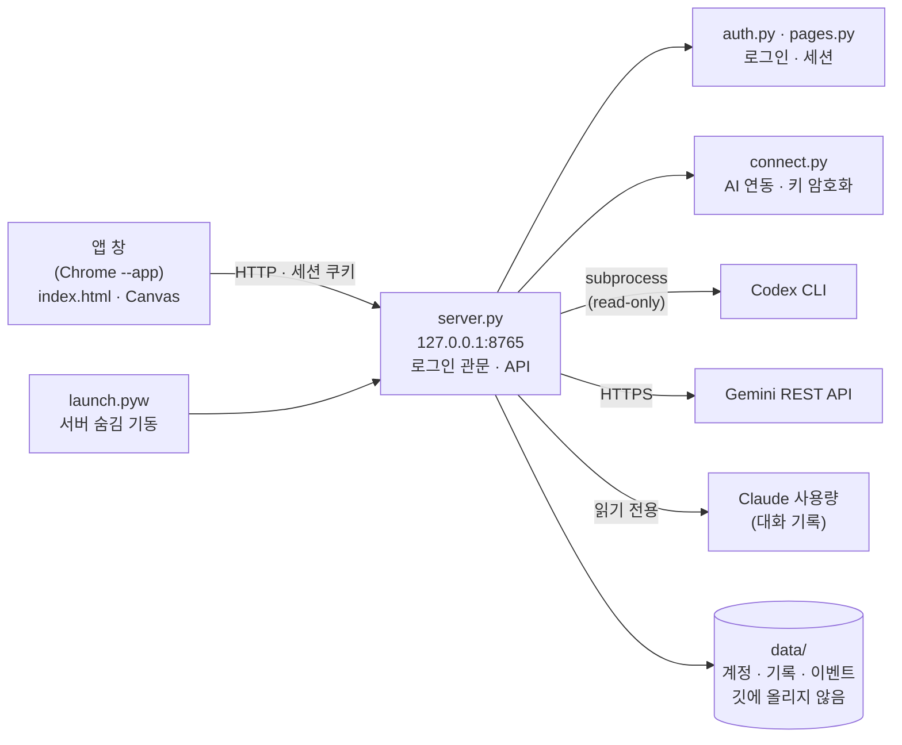

<div align="center">

# AI 팀 관제 · AI Team Console

**Claude · Codex · Gemini를 한 화면에서 부르고 지켜보는 로컬 관제 화면**


 

[발표 자료(PDF)](deliverables/AI관제_발표자료_디자인판.pdf) · [산출물 폴더](deliverables/) · [업로드 계획·WBS](docs/WBS.md)

</div>

> 모든 화면은 **가상(데모) 데이터**로 찍었습니다. 계정·키·호출 기록은 `data/` 폴더에만 저장되고 깃에는 올라가지 않습니다.

## 목차
1. [프로젝트 한눈에 보기](#1-프로젝트-한눈에-보기)
2. [프로젝트 소개](#2-프로젝트-소개)
3. [핵심 기능](#3-핵심-기능)
4. [기술적 의사결정과 문제 해결](#4-기술적-의사결정과-문제-해결)
5. [시스템 아키텍처](#5-시스템-아키텍처)
6. [데이터 저장](#6-데이터-저장)
7. [보안과 개인정보](#7-보안과-개인정보)
8. [화면](#8-화면)
9. [테스트와 검증](#9-테스트와-검증)
10. [시작하기](#10-시작하기)
11. [프로젝트 구조](#11-프로젝트-구조)
12. [개발하며 겪은 문제](#12-개발하며-겪은-문제)
13. [한계와 앞으로](#13-한계와-앞으로)
14. [참고](#14-참고)

---

## 1. 프로젝트 한눈에 보기

| 항목 | 내용 |
|---|---|
| 형태 | 개인 프로젝트(1인) · 내 PC에서만 도는 로컬 웹 앱 |
| 기간 | 2026-11-09 ~ 11-10 |
| 한 줄 소개 | 여러 AI(Claude·Codex·Gemini)의 호출·결과·모델·토큰·한도를 한 화면에서 보고, 이상은 신호로 알려 주는 관제 화면 |
| 기술 | Python 3(표준 라이브러리만, `http.server`) · HTML/CSS/JavaScript · Canvas 2D · Codex CLI · Gemini REST |
| 규모 | 기능 16개 · API 19개 · 화면 디자인 3종 |
| 검증 | 자동 시험 **60개 통과**(로그인 19 · AI 연동 26 · 개인정보 점검 도구 15) |

## 2. 프로젝트 소개

### 배경
AI를 역할별로 나눠 쓰면(Claude=구현, Codex=코드 리뷰, Gemini=설계 리뷰) 좋은 점이 많지만, AI마다 창·터미널이 따로라 **누가 무엇을 하는지, 한도가 얼마나 남았는지**가 흩어져 보입니다. 한도가 다 되면 호출이 실패하는데 원인과 풀리는 시각도 매번 찾아야 했습니다.

### 해결 방향
한 화면에서 호출·결과·모델·토큰·한도를 보고, 이상(실패·한도·연결 끊김)은 신호로 알려 줍니다. 화면 구성은 유튜브 영상의 3단 배치를 참고했고, 코드는 모두 직접 작성했습니다.

### 만들면서 바뀐 방향
| 계기 | 조치 |
|---|---|
| 영상 구성을 따라 만들다 한도에서 멈춤 | AI별 토큰·모델 변경·한도 표시까지 다시 완성 |
| "디자인을 고르고 싶다" | 입자 우주 → 심해 → 관제실을 거쳐 **태양계·심해·관제실(레트로)** 3종을 드롭다운으로 선택 |
| "남이 내 토큰을 쓰면 안 된다" | 앱 로그인 + AI별 **연동 창**. 연결하지 않으면 외부 호출 자체를 하지 않음 |

## 3. 핵심 기능

| 기능 | 설명 |
|---|---|
| 리뷰 병렬 호출 | Codex(코드 리뷰)·Gemini(설계 리뷰)를 **동시에** 호출하고 답을 모아 봅니다. 리뷰어는 읽기 전용입니다. |
| AI별 모델 선택 | AI를 눌러 모델을 고릅니다(Codex는 호출 때만, Gemini는 모델 이름, Claude는 설정의 model 항목). |
| 사용량·한도 | AI별 호출·시간·토큰, Claude 5시간·7일 남은 %와 초기화 시간, Codex 한도 소진 시각, Gemini 429 재시도 시각 |
| 디자인 3종 | 태양계 / 심해 / 관제실 — 상단 '디자인'에서 선택 |
| 관제실 이상 신호 처리 | 호출 실패·한도·연결 끊김을 레이더 신호로 탐지하고, 클릭해서 추적·식별·보류·재시도·해소(정상 신호는 통과) |
| 로그인 | 첫 실행에 내 계정을 만들고, 로그인해야 화면이 열립니다. |
| AI 연동 | Codex·Gemini는 앱의 '연동' 창에서 직접 연결해야만 호출됩니다. 설치·로그인 여부를 확인해 단계별 안내를 보여 줍니다. |
| 앱처럼 실행 | 바로가기를 더블클릭하면 주소창 없는 앱 창으로 열리고, 창을 닫으면 서버도 곧 꺼집니다. |

## 4. 기술적 의사결정과 문제 해결

| 문제 | 해결 | 결과 |
|---|---|---|
| 리뷰어가 프로젝트 파일을 바꾸면? | Codex는 `--sandbox read-only`, Gemini는 REST 호출만 — **의견만 받는 구조** | 리뷰어는 파일을 쓸 수 없음 |
| 리뷰를 하나씩 기다리면 느림 | 리뷰어마다 스레드를 띄워 **병렬 호출** | 가장 느린 리뷰어 시간만큼만 기다림 |
| 남이 이 앱으로 내 토큰을 쓰면? | **연결한 AI만 호출**. 환경 변수·이 PC의 기존 로그인은 기본 꺼짐. 연결이 없으면 외부 호출 없이 '연결 필요'로 종료 | 연결 없이 호출하면 5초 안에 실패(시험으로 확인) |
| Gemini 키를 어떻게 저장하나? | 저장 전 Google에 한 번 확인 → 윈도우 **DPAPI**로 암호화해 저장 | 저장 파일에 평문 키 없음, 화면·응답·로그에도 안 나옴(시험으로 확인) |
| Codex 한도가 풀리는 시각을 알고 싶다 | 한도 응답 문구에서 시각을 읽어 카드에 표시 | 소진 시각 표시 |
| Gemini 429를 받으면? | 응답의 `RetryInfo`·"retry in Ns"·`Retry-After`에서 재시도 시각을 읽음 | 가짜 응답으로 검증 |
| 다른 PC에서는 Claude 사용량을 어떻게? | 햄스터 파일이 없으면 `~/.claude/projects` 대화 기록에서 토큰·초기화 시각을 직접 계산(로그인·네트워크 불필요) | 5시간 초기화 시각이 원본과 거의 일치 |
| 내 계정이 깃에 올라가면? | 기록·계정은 `data/`에만 두고 `.gitignore`, 올리기 전 **개인정보 점검 도구**와 깨끗한 사본 도구 사용 | 올라간 파일에서 개인 경로·이메일·키 0건 |

### 핵심 코드

<details>
<summary><b>병렬 호출 (<code>server.py</code>)</b></summary>

```python
def start_run(prompt, who_list):
    run_id = uuid.uuid4().hex[:8]
    STATE[run_id] = {"prompt": prompt, "started": time.strftime("%Y-%m-%d %H:%M:%S"),
                     "who": {w: {"status": "wait", "output": "", "sec": 0} for w in who_list}}
    for w in who_list:  # 동시에(병렬로) 호출
        threading.Thread(target=run_one, args=(run_id, w), daemon=True).start()
    return run_id

# Codex는 읽기 전용 샌드박스로 호출
'$null | codex exec --sandbox read-only --skip-git-repo-check {model}$env:AI_PROMPT'
```
</details>

<details>
<summary><b>로그인·키 보호 (<code>auth.py</code>, <code>connect.py</code>)</b></summary>

```python
return hashlib.pbkdf2_hmac("sha256", password.encode("utf-8"), salt, iters)
...
ok = hmac.compare_digest(got, bytes.fromhex(rec["hash"])) and hmac.compare_digest(...)

# Windows DPAPI로 키 암호화 (이 PC·이 사용자만 풀 수 있음)
fn = crypt32.CryptProtectData if protect else crypt32.CryptUnprotectData
```
</details>

## 5. 시스템 아키텍처



- 서버는 `127.0.0.1`에서만 듣습니다. 화면(`index.html`)은 외부 라이브러리 없이 Canvas 2D로 그립니다.
- 관제실 화면은 `Events / Targets / Commands / Panel / HUD` 모듈로 나눴습니다.

## 6. 데이터 저장

| 파일 | 내용 |
|---|---|
| `data/auth.json` | 계정 1개 — 비밀번호 원문 없음(해시) |
| `data/runs.jsonl` | 리뷰 호출 기록(한 줄에 한 번의 호출) |
| `data/events.jsonl` | 관제실 이벤트(한 줄에 한 건) |
| `data/models.json` | 화면에서 고른 모델 |
| `data/connections.json` | AI 연동 설정 — Gemini 키는 DPAPI로 암호화 |
| `data/codex_home/` | 앱 전용 Codex 로그인 폴더(`CODEX_HOME`) |

## 7. 보안과 개인정보

| 항목 | 내용 |
|---|---|
| 접속 범위 | 이 PC에서만 열립니다(`127.0.0.1`). Host·Origin 검사로 다른 사이트의 요청을 거절합니다. |
| 로그인 | PBKDF2-SHA256(24만 회)+솔트, 5회 실패 시 60초 잠금, 세션 쿠키 `HttpOnly`·`SameSite=Strict`, 8시간 만료 |
| 토큰 보호 | 앱에서 연결한 AI만 호출. 환경 변수·PC의 기존 로그인은 기본 꺼짐 |
| 키 저장 | 윈도우 DPAPI 암호화(윈도우가 아니면 파일 권한으로만 보호하며 화면에 경고) |
| 업로드 전 점검 | `python -I tools/check_privacy.py . --tracked` — 개인 경로·이메일·키 모양·기록 파일 검사 |
| 깨끗한 사본 | `python -I tools/make_release.py` — 허용 목록 파일만 복사하고 점검까지 실행 |

## 8. 화면

| 태양계 | 심해 | 관제실 |
|---|---|---|
|  |  |  |

| 로그인 | AI 연동(연결 안 된 모습) |
|---|---|
|  |  |

## 9. 테스트와 검증

```bash
python -I tests/test_auth.py       # 로그인 흐름 19개
python -I tests/test_connect.py    # AI 연동 26개
python -I tests/test_privacy.py    # 개인정보 점검 도구 15개
```

| 시험 | 개수 | 검증 내용 |
|---|---:|---|
| 로그인 | 19 | 계정 만들기·로그인·잠금·세션, 다른 사이트(Origin) 요청 거절 |
| AI 연동 | 26 | 연결 전 호출 차단(외부 호출 없이 즉시 실패), 키 형식 검사, 키 암호화·평문 없음, 응답·상태에 키 없음, 연결 해제, 환경 변수 무시 |
| 개인정보 점검 도구 | 15 | 깨끗한 폴더는 통과, 나쁜 폴더(data·auth·기록·바로가기·사용자 경로·이메일·키 모양)는 실패 |

시험은 **임시 폴더·다른 포트의 별도 서버**에서 실행하며 실제 계정·키·외부 서비스는 쓰지 않습니다. 화면은 헤드리스 Chrome과 실제 앱 창으로 직접 확인했습니다.

## 10. 시작하기

필요한 것: Python 3.10 이상(외부 라이브러리 없음), Chrome 또는 Edge.

```bash
python launch.pyw          # 서버를 숨겨서 켜고 앱 창으로 열기 (창을 닫으면 서버도 곧 꺼짐)
# 또는
python -I server.py        # 서버만 켜기 → 브라우저에서 http://127.0.0.1:8765
```

1. 처음 열면 **계정 만들기** 화면이 나옵니다. 아이디(3~32자)와 비밀번호(8자 이상)를 정하세요. 기본 계정은 없습니다.
2. 상단 **연동**에서 AI를 연결합니다. Gemini는 API 키를 붙여넣고, Codex는 로그인 버튼으로 앱 전용 로그인을 합니다.
3. 연동이 없어도 화면은 열리고, 없는 것은 '연결 안 됨'으로 표시됩니다.

### 데모로 보기 (가짜 데이터)
```bash
python -I tools/demo_data.py <빈 폴더>
set AI_CONSOLE_DATA=<그 폴더>& set AI_CONSOLE_DEMO=1& python -I server.py     # 아이디 demo · 시연용 계정
```

## 11. 프로젝트 구조

```
server.py        서버(표준 라이브러리 http.server), 호출·기록·API, 로그인 관문
auth.py          로그인(PBKDF2·세션·잠금)
pages.py         로그인·첫 설정 화면
connect.py       AI 연동(키 암호화 저장·Codex 앱 전용 로그인)
index.html       관제 화면(Canvas 2D) — Events/Targets/Commands/Panel/HUD 모듈
launch.pyw       앱처럼 실행(서버 숨김 기동 + 앱 창)
tests/           자동 시험 (로그인 · AI 연동 · 개인정보 점검)
tools/           데모 데이터 · 스크린샷 · 개인정보 점검 · 깨끗한 사본 · 산출물 생성
deliverables/    산출물(PDF·엑셀) · 발표 PPT · 스크린샷
docs/            업로드 계획 · WBS
```

## 12. 개발하며 겪은 문제

| 문제 | 원인과 해결 |
|---|---|
| 계정 만들기를 누르면 흰 화면에 `{}`만 보임 | 서버가 `Referrer-Policy: no-referrer`를 보내 크롬이 폼 전송에 `Origin: null`을 붙였고, 보안 검사가 이를 외부 요청으로 거절 → `same-origin`으로 변경(검사는 그대로) |
| `python -I`로 실행하면 로그인 모듈을 못 찾음 | `-I`(격리 모드)는 스크립트 폴더를 import 경로에 넣지 않음 → 서버가 자기 폴더를 경로에 추가 |
| 환경 변수의 키가 연동 없이도 쓰일 수 있었음 | 기본 꺼짐으로 바꾸고 앱에서 연결해야만 호출 |
| 다른 PC에서는 Claude 사용량이 안 보임 | Claude Code 대화 기록에서 직접 계산하는 방식을 추가 |
| 설치되지 않은 PC에서 안내가 없음 | 연동 창에 설치·로그인 단계 안내와 명령 복사 추가 |
| 다른 창에 가려진 앱 창에서는 애니메이션이 매우 느려지고 화면 촬영이 멈춤 | 가려진 창은 브라우저가 그리기 속도를 줄임 → 확인용 화면은 헤드리스 Chrome으로 촬영 |

## 13. 한계와 앞으로

- Windows에서만 시험했습니다(DPAPI·바로가기·창 열기가 윈도우 기준).
- 실제 **Codex 로그인(`codex login` 창)과 Gemini 키 검증은 계정이 필요해 직접 해보지 못했습니다**(형식·암호화·해제는 가짜 키로 시험).
- Codex의 성공 응답·토큰 표시는 계정 한도 때문에 확인하지 못했습니다. 실제 Gemini 429 응답 형식도 가짜 응답으로만 검증했습니다.
- Claude 사용량은 다른 PC에서는 한도 퍼센트와 비용을 알 수 없어 토큰 수와 추정 초기화 시각만 보여 줍니다.
- 화면(캔버스) 자동 시험은 없습니다. 다음: 검증기(VERIFIER) 단계 실제 동작, 화면 시험, macOS·Linux.

## 14. 참고

- 화면 구성은 유튜브 '디렉터스AI'의 'AI DEV DIRECTOR' 영상의 화면 구성을 참고했습니다. 영상의 소스 코드·디자인은 사용하지 않았고, 이 프로젝트의 코드는 직접 작성했습니다.
- 글꼴: [Pretendard](https://github.com/orioncactus/pretendard), [JetBrains Mono](https://www.jetbrains.com/lp/mono/) (SIL OFL)
