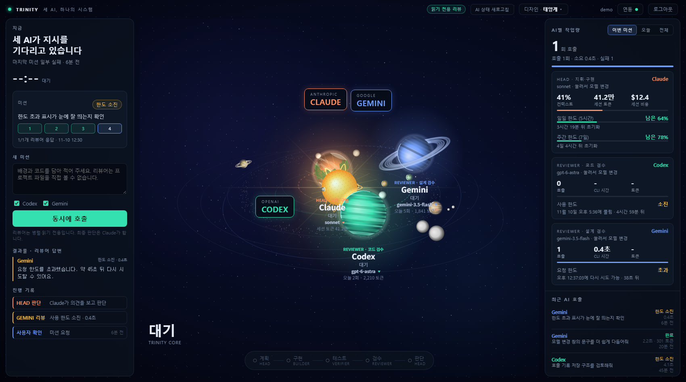
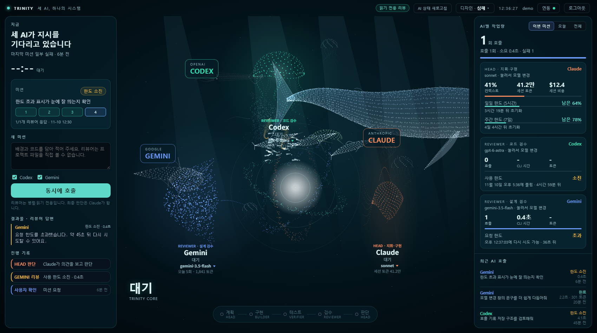
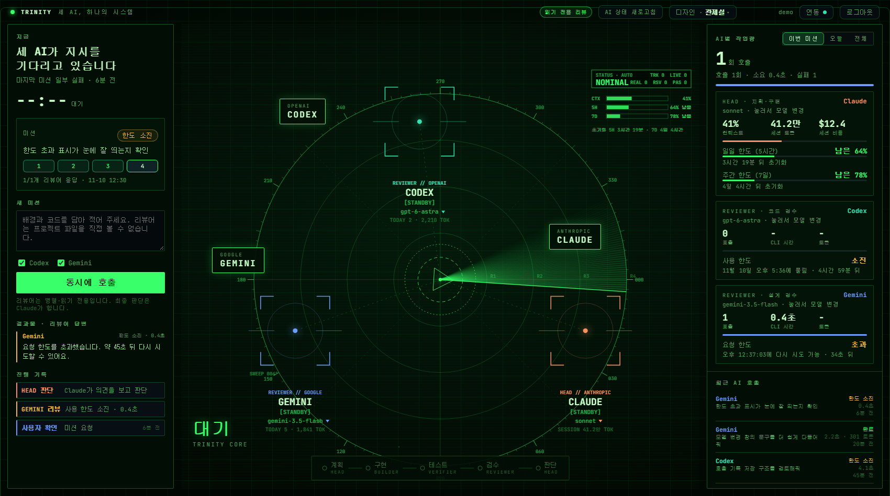

# AI 팀 관제 (AI Team Console)

Claude · Codex · Gemini 가 함께 일하는 모습을 **한 화면에서 호출하고 관찰하는 로컬 관제 화면**입니다. (개인 프로젝트)

| 태양계 | 심해 | 관제실 |
|---|---|---|
|  |  |  |

> 모든 화면은 **가상(데모) 데이터**로 찍었습니다.

## 할 수 있는 것
- **리뷰 병렬 호출** — Codex(코드 리뷰)·Gemini(설계 리뷰)를 동시에 호출하고 답을 모아 봅니다. 리뷰어는 읽기 전용(의견만 줌).
- **AI별 모델 선택** — AI를 눌러 모델을 고릅니다(Codex는 호출 때만, Gemini는 모델 이름, Claude는 설정의 model 항목).
- **사용량·한도** — AI별 호출·시간·토큰, Claude 일일(5시간)·주간(7일) 남은 %와 초기화 시간, Codex 한도 소진 시각, Gemini 429 재시도 시각.
- **디자인 3종** — 태양계 / 심해 / 관제실 (상단 '디자인'에서 선택).
- **관제실 이상 신호 처리** — 호출 실패·한도·연결 끊김을 레이더 신호로 탐지하고, 클릭해서 추적·식별·보류·재시도·해소(정상 신호는 통과).
- **로그인** — 첫 실행에 내 계정을 만들고, 로그인해야 화면이 열립니다.
- **AI 연동** — Codex·Gemini는 앱 상단 '연동' 창에서 직접 연결해야만 호출됩니다(Gemini 키는 암호화 저장, Codex는 앱 전용 로그인). 연결하지 않으면 외부 서비스를 부르지 않아, 남이 내 토큰을 쓸 수 없습니다. 연동 창이 이 PC에 CLI 설치·로그인 여부를 확인해 단계별 안내(설치 명령 복사, 로그인 창 열기)를 보여 줍니다. Claude 사용량은 Claude Code의 대화 기록에서 읽습니다.
- **앱처럼 실행** — 바로가기를 더블클릭하면 주소창 없는 앱 창으로 열립니다.

## 실행

필요한 것: Python 3.10 이상(외부 라이브러리 없음), Chrome 또는 Edge.

```
python launch.pyw          # 서버를 숨겨서 켜고 앱 창으로 열기 (창을 닫으면 서버도 곧 꺼짐)
# 또는
python -I server.py        # 서버만 켜기 → 브라우저에서 http://127.0.0.1:8765
```

처음 열면 **계정 만들기** 화면이 나옵니다. 아이디(3~32자)와 비밀번호(8자 이상)를 정하세요. 기본 계정은 없습니다.
비밀번호는 해시로만 `data/auth.json`에 저장됩니다(잊으면 그 파일을 지우고 다시 설정).

### 연동(선택)
- **Gemini** — 환경 변수 `GEMINI_API_KEY` 가 있으면 호출할 수 있습니다(키는 화면·로그에 남지 않음).
- **Codex** — `codex` 명령(CLI)이 있으면 호출합니다(읽기 전용 샌드박스).
- **Claude 사용량** — Claude Code 사용량 파일이 있으면 한도·컨텍스트를 읽어 옵니다(읽기 전용).

연동이 없어도 화면은 열리고, 없는 것은 '연결 없음'으로 표시됩니다.

### 데모로 보기 (가짜 데이터)
```
python -I tools/demo_data.py <빈 폴더>
set AI_CONSOLE_DATA=<그 폴더>& set AI_CONSOLE_DEMO=1& python -I server.py     # 아이디 demo · 시연용 계정
```

## 보안과 개인정보
- 이 PC에서만 열립니다(127.0.0.1). Host·Origin 검사, 세션 쿠키 HttpOnly·SameSite=Strict, 8시간 만료.
- 비밀번호는 PBKDF2-SHA256(24만 회)+솔트 해시, 5회 실패 시 60초 잠금.
- 호출 내용·이벤트·계정은 `data/` 폴더에만 저장되며 `.gitignore` 로 올라가지 않습니다.
- 올리기 전 점검: `python -I tools/check_privacy.py . --tracked` (개인 경로·이메일·키·기록 파일 검사)
- 깨끗한 사본 만들기: `python -I tools/make_release.py`

## 시험
```
python -I tests/test_auth.py       # 로그인 흐름 19개 (임시 폴더·다른 포트에서 따로 실행)
python -I tests/test_connect.py    # AI 연동 24개 (연결 전 호출 차단·키 암호화)
python -I tests/test_privacy.py    # 개인정보 점검 도구 15개 (나쁜 입력을 잡아내는지)
```

## 구조
```
server.py        서버(표준 라이브러리 http.server), 호출·기록·API, 로그인 관문
auth.py          로그인(PBKDF2·세션·잠금)
pages.py         로그인·첫 설정 화면
connect.py       AI 연동(키 암호화 저장·Codex 앱 전용 로그인)
index.html       관제 화면(Canvas 2D, 외부 라이브러리 없음) — Events/Targets/Commands/Panel/HUD 모듈
launch.pyw       앱처럼 실행(서버 숨김 기동 + 앱 창)
tests/           자동 시험
tools/           데모 데이터·스크린샷·개인정보 점검·깨끗한 사본·산출물 생성
deliverables/    산출물(PDF·엑셀·PPT·스크린샷)
docs/            깃 업로드 계획
```

## 한계
- Windows에서만 시험했습니다.
- Codex의 성공 응답·토큰 표시는 계정 한도 때문에 확인하지 못했습니다.
- 실제 Gemini 429 응답 형식은 아직 못 봤습니다(가짜 응답으로 검증).
- 화면(캔버스) 자동 시험은 없습니다.

## 참고·고마운 곳
- 화면 구성은 유튜브 '디렉터스AI'의 'AI DEV DIRECTOR' 영상의 화면 구성을 참고했습니다(영상의 소스 코드는 사용하지 않았고, 이 프로젝트의 코드는 직접 작성했습니다).
- 글꼴: [Pretendard](https://github.com/orioncactus/pretendard), [JetBrains Mono](https://www.jetbrains.com/lp/mono/) (SIL OFL)
