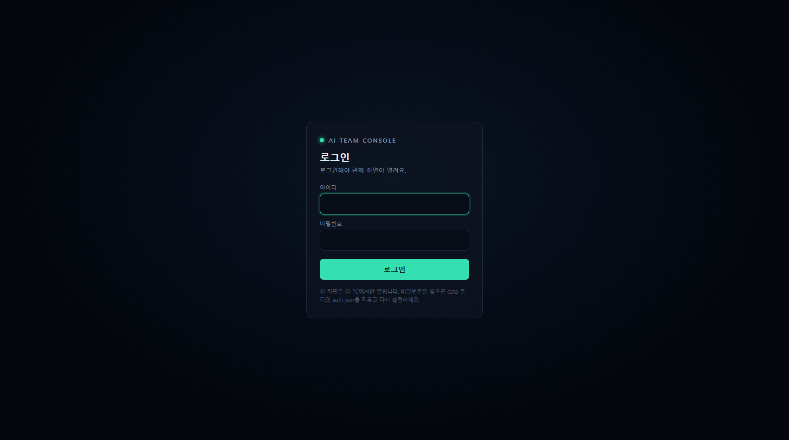
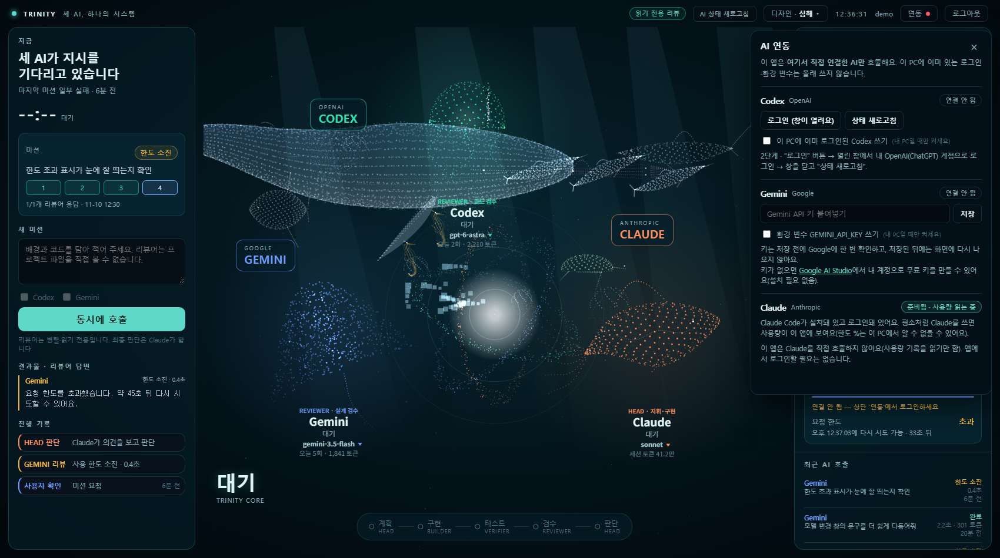
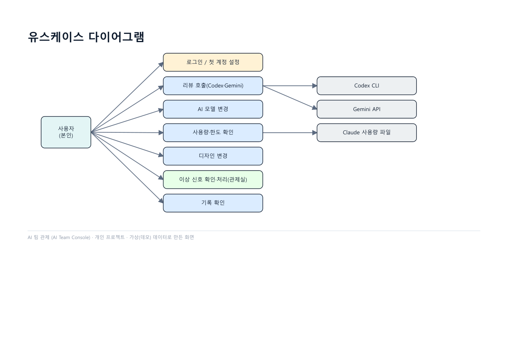
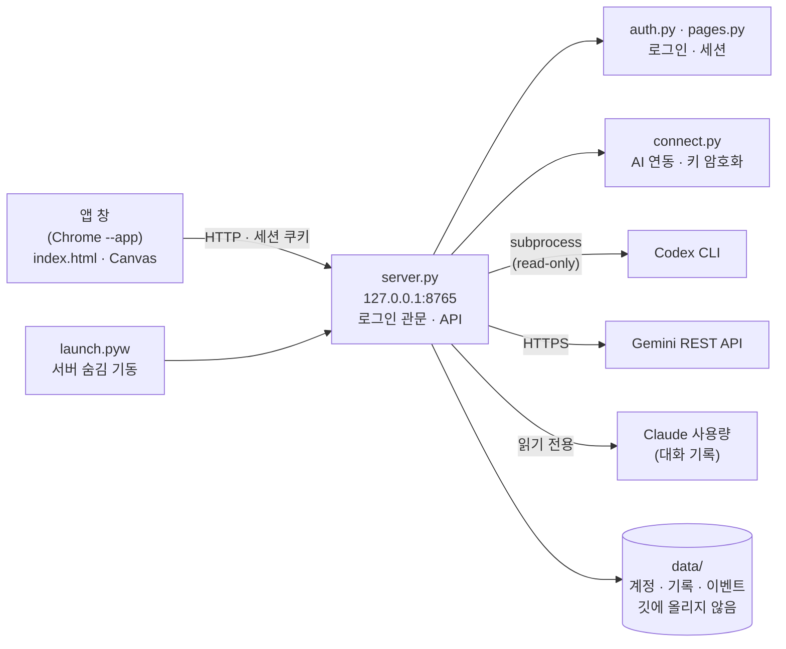
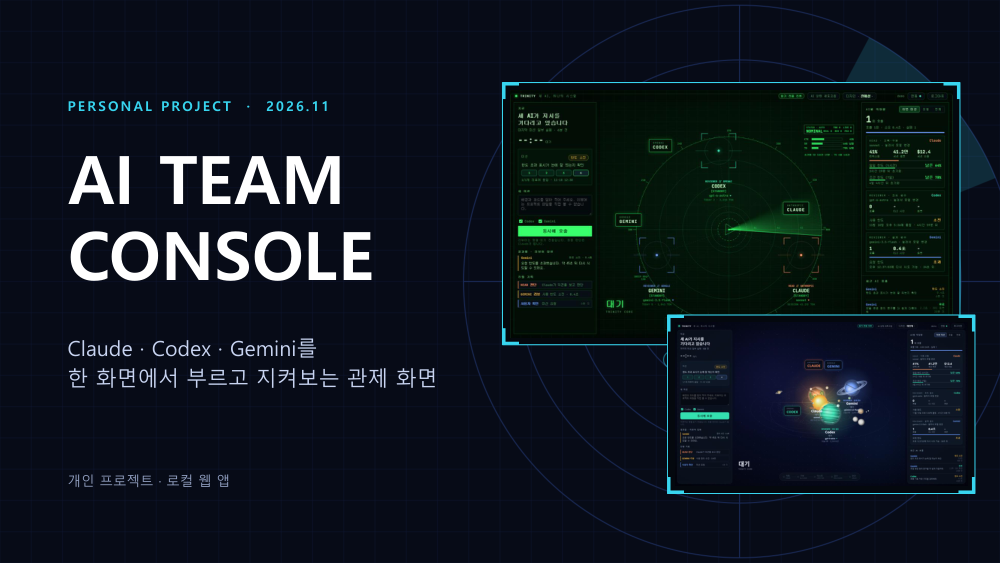
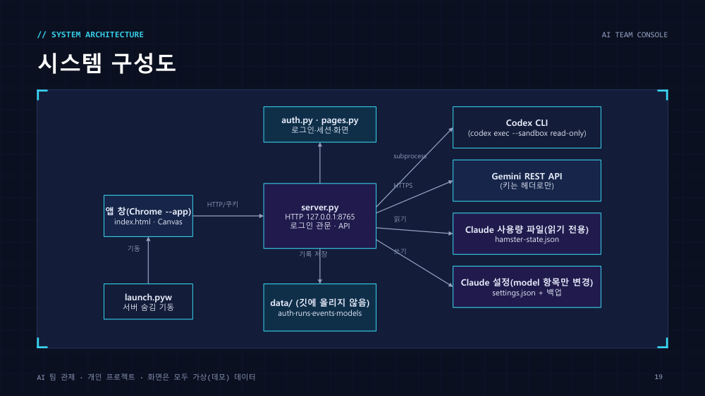
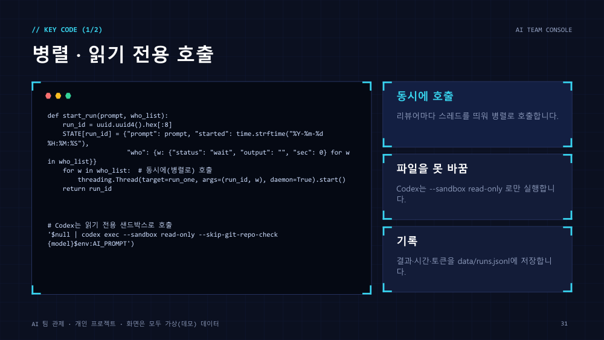
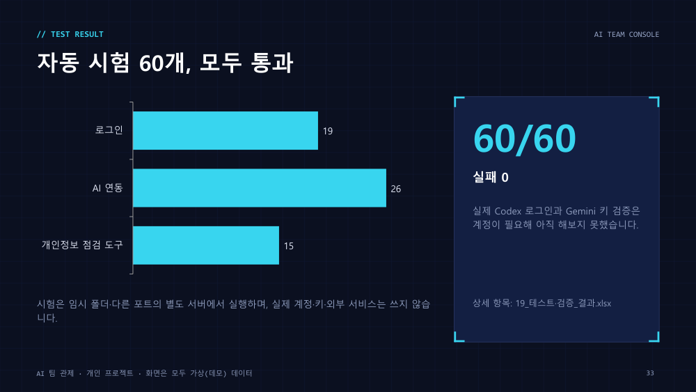

# AI 팀 관제 (AI Team Console)

Claude, Codex, Gemini를 한 화면에서 부르고 지켜보는 내 PC용 관제 화면입니다. 혼자 만든 개인 프로젝트이고 2026년 11월 9일부터 10일까지 만들었습니다.


 

화면은 전부 가짜(데모) 데이터로 찍었습니다. 계정, 키, 호출 기록은 `data/` 폴더에만 저장하고 깃에는 올리지 않습니다.

## 목차
1. [만든 이유](#1-만든-이유)
2. [프로젝트 목표](#2-프로젝트-목표)
3. [주요 기능](#3-주요-기능)
4. [서비스 화면](#4-서비스-화면)
5. [리뷰어 호출과 한도 표시](#5-리뷰어-호출과-한도-표시)
6. [보안과 개인정보](#6-보안과-개인정보)
7. [기술 스택](#7-기술-스택)
8. [시스템 아키텍처와 유스케이스](#8-시스템-아키텍처와-유스케이스)
9. [데이터 저장 명세서](#9-데이터-저장-명세서)
10. [트러블슈팅](#10-트러블슈팅)
11. [테스트 결과](#11-테스트-결과)
12. [프로젝트 산출물](#12-프로젝트-산출물)
13. [향후 개선 계획](#13-향후-개선-계획)
14. [회고](#14-회고)
15. [실행 방법과 폴더 구조](#15-실행-방법과-폴더-구조)
16. [참고](#16-참고)

---

## 1. 만든 이유

Claude, Codex, Gemini를 같이 쓰다 보면 어느 순간 창이 세 개가 되고, 한도가 다 되면 이유도 모른 채 호출이 멈춥니다. 이걸 한 화면에서 볼 수 있으면 어떨까 하는 생각으로 2026년 11월 9일에 이 프로젝트를 시작했습니다.

AI를 하나만 쓰지 않고 역할을 나눠 쓰고 있습니다. Claude가 구현을 맡고, 설계 검토는 Gemini에게, 코드와 보안 검토는 Codex에게 읽기 전용으로 맡깁니다. 이렇게 쓰다 보니 창이 세 개로 나뉘어서 지금 누가 뭘 하는지, 한도가 얼마나 남았는지 한눈에 보이지 않았습니다. 한도가 다 되면 호출이 그냥 실패하는데, 왜 실패했고 언제 풀리는지를 매번 따로 찾아야 했습니다.

그래서 호출과 결과, 모델, 토큰, 한도를 한 화면에 모으기로 했습니다. 화면 배치는 유튜브 '디렉터스AI'의 "AI DEV DIRECTOR" 영상에서 본 3단 구성(왼쪽 미션, 가운데 단계, 오른쪽 AI 현황)을 참고했고, 코드는 영상과 상관없이 직접 썼습니다.

처음에는 영상 화면을 따라 만들다가 한도가 다 차서 멈췄고, 나중에 AI별 토큰 표시와 모델 변경까지 다시 만들어서 마무리했습니다. 디자인은 입자 우주에서 시작해 심해를 거쳐 지금의 태양계, 심해, 관제실 세 가지가 됐고, 상단 드롭다운에서 고릅니다. 연동 창은 "내가 연결하지 않은 AI는 호출되면 안 된다"는 생각에서 나중에 넣었습니다.

기간은 2026-11-09부터 2026-11-10까지이고, 기능은 16개, 서버 API는 19개, 자동 시험은 60개입니다.

## 2. 프로젝트 목표

목표는 눈으로 확인할 수 있는 것만 잡았습니다.

- 호출, 결과, 기록, 한도를 창을 오가지 않고 한 화면에서 봅니다.
- 한도가 다 되었을 때 왜 실패했는지와 언제 풀리는지를 카드에서 바로 봅니다(Codex 소진 시각, Gemini 재시도 시각, Claude 남은 비율).
- 내가 연결한 AI만 호출되게 합니다. 이 앱을 여는 다른 사람이 내 토큰을 쓰지 못해야 합니다.
- 설치와 로그인 상태가 다른 PC에서도 막히지 않고, 안 된 이유와 다음에 할 일이 화면에 나오게 합니다.

## 3. 주요 기능

- Codex(코드 리뷰)와 Gemini(설계 리뷰)에게 같은 요청을 동시에 보내고 답을 모아 봅니다. 리뷰어는 의견만 줄 수 있고 파일을 바꾸지는 못합니다.
- AI를 눌러 모델을 고릅니다. Codex는 호출할 때만 쓰는 모델이고, Gemini는 모델 이름, Claude는 설정 파일의 `model` 항목을 바꿉니다.
- AI별 호출 횟수와 걸린 시간, 토큰을 보여 줍니다. Claude는 5시간과 7일 한도의 남은 비율과 초기화까지 남은 시간, Codex는 한도가 풀리는 시각, Gemini는 429가 났을 때 재시도 가능한 시각을 카드에 표시합니다.
- 관제실 디자인에서는 호출 실패, 한도, 연결 끊김을 레이더 신호로 보여 줍니다. 신호를 눌러 추적, 식별, 보류, 재시도, 해소를 고르고, 정상 신호는 통과시킵니다.
- 첫 실행에서 계정을 만들어야 화면이 열립니다. 상단 연동 창에서 Gemini 키와 Codex 로그인을 직접 연결해야 그 AI를 호출할 수 있습니다.
- 바로가기를 더블클릭하면 주소창 없는 앱 창으로 열리고, 창을 닫으면 서버도 곧 꺼집니다.

## 4. 서비스 화면

### 세 가지 디자인
상단의 디자인 드롭다운에서 고릅니다. 태양계는 세 AI가 행성이 되어 태양 둘레를 돌고, 작업 중이면 행성이 빨라집니다. 심해는 입자로 그린 해파리, 가오리, 고래가 헤엄칩니다. 관제실은 레트로 레이더 화면입니다.

  

### 로그인과 AI 연동
첫 실행에서는 계정 만들기가 나옵니다. 연동 창에서 Gemini 키를 붙여넣고 Codex는 로그인 버튼으로 로그인하며, 연결하지 않은 AI는 카드에 "연결 안 됨"이 뜨고 리뷰어 체크칸이 꺼집니다. 아래는 아직 아무것도 연결하지 않은 상태입니다.

 

## 5. 리뷰어 호출과 한도 표시

### 리뷰어 호출

리뷰 요청이 오면 리뷰어마다 스레드를 하나씩 띄워서 동시에 부릅니다. 가장 느린 리뷰어 시간만큼만 기다리면 됩니다.

```python
def start_run(prompt, who_list):
    run_id = uuid.uuid4().hex[:8]
    STATE[run_id] = {"prompt": prompt, "started": time.strftime("%Y-%m-%d %H:%M:%S"),
                     "who": {w: {"status": "wait", "output": "", "sec": 0} for w in who_list}}
    for w in who_list:  # 동시에(병렬로) 호출
        threading.Thread(target=run_one, args=(run_id, w), daemon=True).start()
    return run_id
```

Codex는 `codex exec --sandbox read-only`로 부릅니다. 읽기 전용 샌드박스라서 리뷰 도중에 프로젝트 파일을 바꾸지 못하고, Gemini는 REST로 답만 받아 옵니다. 결과, 걸린 시간, 모델, 토큰은 `data/runs.jsonl`에 한 줄씩 쌓입니다.

### 한도와 사용량

한도 표시는 AI마다 구하는 방법이 달랐습니다.

Codex는 한도가 다 되면 응답 문구에 풀리는 날짜와 시각이 영어로 들어 있어서, 마지막 호출이 한도 응답이면 그 시각을 읽어 카드에 보여 줍니다. Gemini는 429 응답의 `RetryInfo`, "retry in Ns" 문구, `Retry-After` 헤더에서 재시도 가능한 시각을 읽습니다. 실제 Gemini 429 응답은 아직 받아 보지 못해서 이 부분은 가짜 응답으로만 확인했습니다.

Claude는 서버에 물어보지 않습니다. 처음에는 이 PC에서 돌아가는 사용량 표시 도구가 쓰는 파일(`hamster-state.json`)을 읽었는데, 그러면 다른 PC에서는 아무것도 안 보였습니다. 그래서 그 파일이 없으면 Claude Code가 남기는 대화 기록(`~/.claude/projects`)에서 최근 5시간과 7일 동안 쓴 토큰을 직접 세고, 초기화 시각은 5시간 구간의 첫 메시지 시각에 5시간을 더해 추정합니다. 이 PC에서는 추정한 시각이 원래 값과 몇 분 차이였습니다. 다만 한도의 퍼센트와 비용은 서비스 쪽 값이라 기록으로는 알 수 없어서, 그런 PC에서는 토큰 수와 추정 시각만 보여 줍니다.

## 6. 보안과 개인정보

이 앱이 내 PC에서 돌아가니까, 누군가 이 앱을 열면 내 Codex나 Gemini 토큰으로 호출할 수 있게 됩니다. 이걸 막으려고 두 겹으로 잠갔습니다.

먼저 앱 로그인입니다. 첫 실행에서 정한 아이디와 비밀번호가 있어야 화면이 열립니다. 비밀번호는 PBKDF2-SHA256(24만 번)과 솔트로 해시해서만 저장하고, 비교는 `hmac.compare_digest`로 합니다. 5번 틀리면 60초 동안 잠기고, 세션 쿠키는 `HttpOnly`와 `SameSite=Strict`에 8시간 만료입니다. 서버는 `127.0.0.1`에서만 듣고, Host와 Origin을 검사해서 다른 사이트에서 날아온 요청은 거절합니다.

그다음은 AI별 연동입니다. 로그인했더라도 연동 창에서 직접 연결하지 않은 AI는 외부 서비스를 부르지 않고 "연결 필요"로 바로 끝납니다. 환경 변수에 키가 있거나 이 PC에 이미 Codex 로그인이 있어도 기본으로는 쓰지 않고, 연동 창에서 켜야 합니다.

- Gemini 키는 저장하기 전에 Google에 한 번 물어서 쓸 수 있는 키인지 확인합니다. 그다음 윈도우 DPAPI로 암호화해서 `data/connections.json`에 저장합니다. 이 PC의 이 사용자 계정만 풀 수 있고, 화면, API 응답, 로그 어디에도 키가 나오지 않습니다. 윈도우가 아니면 암호화를 쓸 수 없어서 파일 권한으로만 보호하고 화면에 경고를 띄웁니다.
- Codex는 이 앱 전용 로그인 폴더(`CODEX_HOME`)를 따로 씁니다. 연동 창의 로그인 버튼이 새 터미널 창으로 `codex login`을 열어 줍니다.

```python
return hashlib.pbkdf2_hmac("sha256", password.encode("utf-8"), salt, iters)
...
fn = crypt32.CryptProtectData if protect else crypt32.CryptUnprotectData   # Windows DPAPI
```

연동 창은 이 PC에 Claude Code, Codex CLI가 설치돼 있는지와 로그인돼 있는지도 확인합니다. 없으면 설치 명령을 복사할 수 있게 보여 주고, 로그인 버튼으로 창을 열어 줍니다. 사람마다 PC 환경이 다르니까 "안 된다"에서 끝나지 않고 다음에 뭘 해야 하는지가 화면에 나와야 한다고 생각했습니다.

저장소에 올리기 전에는 `python -I tools/check_privacy.py . --tracked`로 개인 경로, 이메일, 키 모양의 문자열, 기록 파일이 섞이지 않았는지 검사하고, `python -I tools/make_release.py`로 허용 목록에 있는 파일만 복사한 깨끗한 사본을 만듭니다. 이 저장소도 그 사본에서 올렸습니다. 점검 결과는 [26_보안·개인정보_점검.pdf](deliverables/26_보안·개인정보_점검.pdf)에 정리했습니다.

## 7. 기술 스택

| 구분 | 사용한 것 |
|---|---|
| 서버 | Python 3 표준 라이브러리(`http.server`), 외부 패키지 없음 |
| 화면 | HTML, CSS, JavaScript, Canvas 2D |
| AI 연결 | Codex CLI(읽기 전용 샌드박스), Gemini REST API, Claude Code 대화 기록(사용량) |
| 보안 | PBKDF2-SHA256, 윈도우 DPAPI, Host·Origin 검사 |
| 실행 | `launch.pyw`(서버 숨김 기동 + Chrome/Edge `--app` 창) |
| 개발 환경 | Windows 10, 화면 확인은 헤드리스 Chrome |

## 8. 시스템 아키텍처와 유스케이스

### 유스케이스



### 시스템 아키텍처



서버는 파이썬 표준 라이브러리의 `http.server`만 씁니다. 화면(`index.html`)은 외부 라이브러리 없이 Canvas 2D로 그리고, 관제실 쪽 코드는 Events, Targets, Commands, Panel, HUD 모듈로 나눴습니다. 구성도 PDF는 [12_시스템·서비스_구성도.pdf](deliverables/12_시스템·서비스_구성도.pdf), 유스케이스는 [10_유스케이스_다이어그램.pdf](deliverables/10_유스케이스_다이어그램.pdf)입니다.

## 9. 데이터 저장 명세서

DB 없이 `data/` 폴더의 파일에 저장합니다. 이 폴더는 `.gitignore`에 들어 있습니다.

| 파일 | 필드 | 설명 |
|---|---|---|
| `data/auth.json` | user, salt, iter, hash, created | 계정 1개. 비밀번호 원문 없음(해시) |
| `data/runs.jsonl` | id, prompt, started, who{codex\|gemini: status, output, sec, model, tokens, reason, reset_at} | 한 줄에 한 번의 리뷰 호출 |
| `data/events.jsonl` | ts, tag, text, target, sim | 관제실 이벤트 한 줄 |
| `data/models.json` | codex, gemini | 화면에서 고른 모델(전역 설정은 건드리지 않음) |
| `data/connections.json` | gemini{key(암호화), protected, use_env}, codex{use_system} | AI 연동 설정. 키는 DPAPI로 암호화 |
| `data/codex_home/` | auth.json 등(Codex CLI가 만듦) | 앱 전용 Codex 로그인 폴더(CODEX_HOME) |

엑셀 원본은 [14_데이터_저장파일_명세서.xlsx](deliverables/14_데이터_저장파일_명세서.xlsx)입니다.

## 10. 트러블슈팅

<details>
<summary>계정 만들기를 누르면 흰 화면에 {}만 떴습니다</summary>

문제: 첫 설정 화면에서 계정 만들기를 누르면 흰 화면에 `{}`만 보이고 계정이 만들어지지 않았습니다.
원인: 서버가 `Referrer-Policy: no-referrer`를 보내서 크롬이 폼 전송에 `Origin: null`을 붙였습니다. 제가 넣어 둔 보안 검사가 그 요청을 다른 사이트에서 온 것으로 보고 거절한 것이었습니다.
해결: 헤더를 `same-origin`으로 바꿨습니다. 같은 주소에서 보낸 요청에는 진짜 주소가 붙고, 다른 사이트로는 여전히 아무 정보도 나가지 않습니다. 보안 검사는 그대로 뒀습니다.
</details>

<details>
<summary>python -I로 실행하면 로그인 모듈을 찾지 못했습니다</summary>

문제: `python -I server.py`로 띄우면 `auth`, `pages` 모듈을 가져오지 못했습니다.
원인: 격리 모드(`-I`)는 스크립트가 있는 폴더를 import 경로에 넣지 않습니다.
해결: 서버가 시작할 때 자기 폴더를 경로에 직접 추가합니다.
</details>

<details>
<summary>환경 변수의 키가 연동 없이도 쓰일 수 있었습니다</summary>

문제: 환경 변수에 `GEMINI_API_KEY`가 있으면 연동 창에서 연결하지 않아도 Gemini가 호출됐습니다.
원인: 처음에는 편하게 환경 변수를 그대로 읽었습니다. 그런데 이러면 이 앱을 여는 누구나 내 키로 호출할 수 있습니다.
해결: 환경 변수와 이 PC의 기존 Codex 로그인은 기본 꺼짐으로 바꾸고, 연동 창에서 직접 켜야만 쓰이게 했습니다. 연결 없이 호출하면 외부 서비스를 부르지 않고 바로 실패하는지는 시험으로 확인합니다.
</details>

<details>
<summary>다른 PC에서는 Claude 사용량이 안 보였습니다</summary>

문제: 사용량 카드가 이 PC에서는 나오는데 다른 PC에서는 비어 있었습니다.
원인: 이 PC에서만 돌아가는 사용량 표시 도구의 파일을 읽고 있었습니다.
해결: 그 파일이 없으면 Claude Code의 대화 기록에서 토큰을 직접 세도록 했습니다. 대신 한도 퍼센트와 비용은 서비스 쪽 값이라 알 수 없어서, 그런 PC에서는 토큰 수와 추정 초기화 시각만 보여 줍니다.
</details>

<details>
<summary>설치되지 않은 PC에서는 어떻게 해야 하는지 알 수 없었습니다</summary>

문제: Codex CLI나 Claude Code가 없는 PC에서 연동 창을 열어도 무엇을 해야 하는지 안내가 없었습니다.
해결: 연동 창이 설치와 로그인 여부를 확인해서 단계별로 안내합니다. 설치 명령은 복사할 수 있게 보여 주고, 로그인 버튼은 새 터미널 창으로 해당 명령을 열어 줍니다. 맥과 리눅스처럼 창을 자동으로 열 수 없는 환경에서는 명령을 직접 실행하라는 안내가 뜹니다.
</details>

<details>
<summary>다른 창에 가려진 앱 창이 거의 멈췄습니다</summary>

문제: 화면 촬영이 계속 시간 초과가 났고, 애니메이션이 1초에 한 장쯤으로 느려 보였습니다.
원인: 다른 창에 가려진 창은 브라우저가 그리기 속도를 크게 줄입니다.
해결: 확인용 화면은 헤드리스 Chrome으로 찍습니다.
</details>

## 11. 테스트 결과

```bash
python -I tests/test_auth.py       # 로그인 19개
python -I tests/test_connect.py    # AI 연동 26개
python -I tests/test_privacy.py    # 개인정보 점검 도구 15개
```

시험은 임시 폴더와 다른 포트에 따로 띄운 서버에서 돌아서 내 실제 계정, 키, 외부 서비스를 건드리지 않습니다. 세 파일 합쳐서 60개이고 지금은 전부 통과합니다.

- 로그인 19개: 계정 만들기, 로그인, 잠금, 세션, 다른 사이트의 요청 거절
- AI 연동 26개: 연결하지 않으면 5초 안에 외부 호출 없이 실패하는지, 키 형식 검사, 저장 파일에 평문 키가 없는지, 응답과 상태에 키가 없는지, 연결을 해제하면 키가 사라지는지, 환경 변수의 키를 몰래 쓰지 않는지
- 개인정보 점검 도구 15개: 깨끗한 폴더는 통과하고, `data` 폴더, `auth.json`, 호출 기록, 바로가기, 내 PC 경로, 이메일, 키 모양이 든 폴더는 실패하는지

<details>
<summary>시험 항목 전체 (60개)</summary>

로그인

| 번호 | 시험 |
|---|---|
| 1 | 계정이 없으면 /가 /setup으로 보낸다 |
| 2 | 로그인 전 API는 401 |
| 3 | 다른 사이트(Origin)에서 온 설정 요청은 거절 |
| 4 | 8자 미만 비밀번호는 거절 |
| 5 | 비밀번호 확인이 다르면 거절 |
| 6 | 올바르게 설정하면 /login으로 이동 |
| 7 | 비밀번호 원문이 저장 파일에 없다 |
| 8 | 계정이 생긴 뒤 /setup은 다시 못 연다 |
| 9 | 계정이 있는데 다시 설정(덮어쓰기)은 거절 |
| 10 | 틀린 비밀번호는 401 |
| 11 | 로그인 성공 → 쿠키 발급(HttpOnly, SameSite=Strict) |
| 12 | 로그인 후 /는 화면이 열린다 |
| 13 | /api/me가 아이디를 알려 준다 |
| 14 | 로그인 후 API 허용 |
| 15 | 다른 사이트(Origin) 요청은 로그인돼 있어도 거절 |
| 16 | 로그아웃 |
| 17 | 로그아웃 뒤 API는 다시 401 |
| 18 | 연속 실패하면 잠금(429) |
| 19 | 잠금 중에는 맞는 비밀번호도 막는다 |

AI 연동

| 번호 | 시험 |
|---|---|
| 1 | 로그인 전에는 연동 설정을 못 바꾼다(401) |
| 2 | 다른 사이트(Origin)의 연동 변경 요청은 거절(403) |
| 3 | 환경 변수에 키가 있어도 처음에는 연결 안 됨(몰래 쓰지 않는다) |
| 4 | Codex도 처음에는 연결 안 됨(이 PC의 기존 로그인을 쓰지 않는다) |
| 5 | Claude는 로그인이 필요 없다는 안내 |
| 6 | 연결 없이 호출하면 Codex·Gemini 모두 연결 필요로 실패 |
| 7 | 외부 호출 없이 즉시 끝난다(5초 안) |
| 8 | 실패 안내에 연동이 들어 있다 |
| 9 | 잘못된 형식의 키는 거절(400) |
| 10 | 키를 저장하면 연결됨(저장) |
| 11 | 응답 어디에도 키가 없다 |
| 12 | 저장 파일에 키 평문이 없다 |
| 13 | 윈도우에서는 암호화(DPAPI)되어 저장된다 |
| 14 | 상태 조회에도 키가 없다 |
| 15 | 연결 해제하면 다시 연결 안 됨 |
| 16 | 해제 뒤 저장 파일에서 키가 사라진다 |
| 17 | 환경 변수 쓰기를 켜면 그때부터 연결됨(env) |
| 18 | 다시 끄면 연결 안 됨 |
| 19 | 이 PC의 Codex 로그인 쓰기는 실제 로그인이 있을 때만 연결 |
| 20 | 끄면 다시 연결 안 됨 |
| 21 | 알 수 없는 요청은 거절(400) |
| 22 | 암호화해 저장한 키를 꺼내면 원래 키와 같다 |
| 23 | 연결하지 않은 곳에서는 키가 나오지 않는다(환경 변수 무시) |
| 24 | 연결하지 않으면 Codex 환경도 없다(None) |
| 25 | 설치·로그인 안내용 상태가 있다(Claude 설치/로그인 여부, 이 PC 종류) |
| 26 | 상태에 토큰·키 값은 없다(있는지 여부만) |

개인정보 점검 도구

| 번호 | 시험 |
|---|---|
| 1 | 깨끗한 폴더는 통과 |
| 2 | 나쁜 폴더는 실패(종료 코드 1) |
| 3 | 잡아낸다: data 폴더 |
| 4 | 잡아낸다: auth.json |
| 5 | 잡아낸다: runs.jsonl |
| 6 | 잡아낸다: 바로가기(.lnk) |
| 7 | 잡아낸다: 사용자 경로 |
| 8 | 잡아낸다: 이메일 |
| 9 | 잡아낸다: Google API 키 모양 |
| 10 | 잡아낸다: GitHub 토큰 |
| 11 | 잡아낸다: 비공개 키 블록 |
| 12 | 잡아낸다: 사설 IP |
| 13 | 사설 낱말 목록의 낱말을 잡아낸다 |
| 14 | --tracked: .gitignore 로 제외된 data/ 는 문제 삼지 않는다 |
| 15 | --tracked: 올라갈 파일의 이메일은 잡아낸다 |

</details>

<details>
<summary>화면에서 직접 확인한 항목 (20개)</summary>

| 항목 | 결과 | 비고 |
|---|---|---|
| Gemini 리뷰 호출·토큰 표시 | 확인 | 토큰 155~176, 응답 2~4초 |
| Codex 호출(한도 소진 응답 처리) | 확인 | 성공 응답은 계정 한도 때문에 미확인 |
| Gemini 모델 변경 후 호출 | 확인 | gemini-3.6-flash 로 변경해 호출 성공 |
| Claude 모델 저장(settings.json model만 변경·백업) | 확인 | 다른 항목 그대로 |
| Claude 5시간·7일 한도 남은 %·초기화 시간 표시 | 확인 | 햄스터와 같은 값 |
| Codex 한도 소진 시각 표시 | 확인 | 응답 문구에서 시각 파싱 |
| Gemini 429 재시도 시각 표시 | 가짜 응답으로 확인 | 실제 429는 일으키지 못함 |
| 디자인 3종 전환·기억 | 확인 |  |
| 관제실 신호 탐지→추적→식별→해소 | 확인 | 실제 이상(Codex 한도) 신호 포함 |
| 관제실 재시도 명령(실제 재호출) | 확인 | 한도로 실패 → 실패로 표시 |
| 정상 신호 통과 승인→PASSED | 확인 | 로그·카운터 확인 |
| 앱 실행(서버 숨김 기동) / 창 닫으면 자동 종료 | 확인 | 자동 종료는 20초 설정으로 시험 |
| 데모 모드 스크린샷(개인 기록 없음) | 확인 | 가짜 기록·가짜 사용량 |
| 깨끗한 사본(release/) 개인정보 점검 | 확인 | 의심 항목 없음, 나쁜 입력을 잡아내는 것은 자동 시험 15개로 확인 |
| 연동 창: 연결 안 됨 표시·체크칸 비활성·카드 안내(화면) | 확인 | 첫 방문에 연동 창이 자동으로 열림 |
| Gemini 실제 키 저장(Google 확인)·실제 호출 | 미확인 | 실제 키를 쓰지 않고 시험함(형식·암호화·해제는 확인) |
| Codex 앱 로그인(codex login 창) | 미확인 | 계정 로그인이 필요해 직접 해 보지 않음 |
| 모바일·좁은 화면 | 미확인 |  |
| Codex 토큰 표시 | 미확인 | 성공 응답이 있어야 확인 가능 |
| macOS·Linux | 미확인 | Windows에서만 시험 |

</details>

캔버스 화면 자체의 자동 시험은 없습니다. 엑셀 원본은 [19_테스트·검증_결과.xlsx](deliverables/19_테스트·검증_결과.xlsx)입니다.

## 12. 프로젝트 산출물

프로젝트를 진행하면서 만든 문서와 표를 여기에 모았습니다. 원본 파일은 [deliverables](deliverables/) 폴더에 번호를 붙여 두었고(PDF와 엑셀), 이 README의 표와 그림은 그 내용을 옮긴 것입니다.

### WBS

혼자 하는 프로젝트라 일정은 크게 나눠서만 잡았습니다. 표의 날짜는 실제로 작업한 날입니다.

| 단계 | 작업 | 시작 | 종료 | 상태 |
|---|---|---|---|---|
| 기획 | 목표·범위 정리, 영상 화면 구성 분석 | 2026-11-09 | 2026-11-09 | 완료 |
| 서버 | Python 서버, Codex/Gemini 병렬 호출, 호출 기록 저장 | 2026-11-09 | 2026-11-09 | 완료 |
| 화면 | 3단 대시보드, AI별 사용량·토큰, 모델 선택 | 2026-11-09 | 2026-11-10 | 완료 |
| 디자인 | 입자 우주 → 심해 → 관제실, 이후 태양계·심해·관제실 3종으로 정리 | 2026-11-09 | 2026-11-10 | 완료 |
| 관제실 | 신호 탐지 레이더, 목표물 선택·명령, 자동 처리, 이벤트 로그 | 2026-11-10 | 2026-11-10 | 완료 |
| 한도 표시 | Claude 일일·주간 한도, Codex·Gemini 한도 시각 | 2026-11-10 | 2026-11-10 | 완료 |
| 보안 | 로그인(첫 설정·세션·잠금), data 폴더 분리, 자동 시험 19개 | 2026-11-10 | 2026-11-10 | 완료 |
| 실행 | 앱처럼 실행(런처·바로가기·자동 종료), 데모 모드 | 2026-11-10 | 2026-11-10 | 완료 |
| 산출물 | 문서·엑셀·PPT, 스크린샷(가짜 데이터) | 2026-11-10 | 2026-11-10 | 완료 |
| 공개 준비 | 개인정보 점검 도구, 깨끗한 사본, 날짜별 업로드 계획 | 2026-11-10 | 2026-11-10 | 완료 |
| 업로드 | 날짜별로 나누어 깃에 업로드(계획표 참고) | 2026-11-10 | 2026-11-14 | 예정 |
| 후속 | Codex 성공 응답 확인(한도 해제 후), 검증기(VERIFIER) 단계 실제 동작 | 미정 | 미정 | 예정 |

### 기능 명세서와 요구사항

<details>
<summary>기능 요구사항 (16개)</summary>

| ID | 구분 | 기능 | 설명 | 검증 |
|---|---|---|---|---|
| FR-01 | 리뷰 | 리뷰 병렬 호출 | Codex·Gemini를 동시에 호출하고 답을 한 화면에 모아 보여 준다. 리뷰어는 읽기 전용(의견만 줌) | Chrome에서 실제 호출 확인(Gemini 성공, Codex는 계정 한도로 실패 표시) |
| FR-02 | 리뷰 | 호출 기록 저장·조회 | 요청 문장·결과·시간·사용한 모델·토큰을 runs.jsonl에 저장하고 최근 기록을 보여 준다 | 확인 |
| FR-03 | 모델 | AI별 모델 선택 | AI(노드/카드)를 누르면 모델 목록·직접 입력·기본값 되돌리기. Codex는 호출 때만 -m, Gemini는 모델 이름 지정, Claude는 settings.json의 model만 변경(백업) | Gemini·Codex 변경 확인, Claude 저장 확인 |
| FR-04 | 사용량 | AI별 호출·시간·토큰 | 이번 미션/오늘/전체 탭으로 호출 수·CLI 시간·토큰을 보여 준다. Gemini 토큰은 API 응답에서 읽음 | Gemini 토큰 확인, Codex 토큰은 성공 응답 미확인 |
| FR-05 | 사용량 | Claude 한도 표시 | 일일(5시간)·주간(7일) 남은 %와 초기화까지 남은 시간, 컨텍스트, 세션 토큰·비용(읽기 전용) | 확인 |
| FR-06 | 사용량 | 한도 소진 시각 | Codex 한도 소진 시 풀리는 시각, Gemini 429 응답의 재시도 시각을 카드에 표시 | Codex 확인 / Gemini는 가짜 응답으로 검증 |
| FR-07 | 상태 | 연결 상태 | Codex CLI·Gemini API·Claude Code 연결 여부 표시(키 값은 읽지 않음) | 확인 |
| FR-08 | 화면 | 디자인 3종 전환 | 태양계 / 심해 / 관제실. 상단 '디자인' 드롭다운에서 고르고, 고른 값을 기억 | 확인 |
| FR-09 | 관제실 | 이상 신호 탐지 레이더 | 호출 실패·한도 소진·컨텍스트/한도 임계 초과·연결 끊김을 레이더 신호로 표시. 연습용 SIM 신호도 지나감 | 확인 |
| FR-10 | 관제실 | 목표물 선택·명령 | 신호 클릭 → 상세 패널(방위·거리·속도·도달 예상) + 명령(추적·식별·보류·재시도·해소·통과) | 확인 |
| FR-11 | 관제실 | 자동 처리·연출 | 탐지→추적→식별→해소(정상 신호는 통과)를 자동 진행, ANALYZING 진행 링 + 입자 분해 + 도장 | 확인 |
| FR-12 | 관제실 | 이벤트 기록 | 상태 변경·명령·결과를 events.jsonl에 저장 | 확인 |
| FR-13 | 보안 | 로그인 | 첫 실행 때 계정 생성, 로그인해야 화면이 열림, 로그아웃, 연속 실패 잠금 | 자동 시험 19개 통과 |
| FR-14 | 실행 | 앱처럼 실행 | 바로가기 더블클릭 → 서버가 보이지 않게 켜지고 주소창 없는 앱 창으로 열림, 창을 닫으면 서버 자동 종료 | 확인(서버 기동·자동 종료) |
| FR-16 | 보안 | AI 연동(로그인) | Codex·Gemini는 앱의 '연동' 창에서 직접 연결해야 호출된다(Gemini 키 입력·암호화 저장, Codex 앱 전용 로그인). 연결 전에는 외부 호출 없이 멈춘다. 이 PC의 기존 로그인·환경 변수는 사용자가 켠 경우에만 사용 | 자동 시험 26개 통과 / 실제 키·실제 Codex 로그인은 미확인 |
| FR-15 | 시연 | 데모 모드 | 가짜 기록·가짜 사용량으로 동작해 스크린샷·시연에 개인 기록이 섞이지 않게 함 | 확인 |

</details>

<details>
<summary>비기능 요구사항 (9개)</summary>

| ID | 구분 | 요구사항 |
|---|---|---|
| NFR-01 | 보안 | 이 PC에서만 열림(127.0.0.1), Host·Origin 검사 |
| NFR-02 | 보안 | 비밀번호는 PBKDF2-SHA256(24만 회)+솔트 해시로만 저장, 원문 저장·로그 없음 |
| NFR-03 | 보안 | 세션 쿠키 HttpOnly·SameSite=Strict, 8시간 만료, 서버를 끄면 모두 로그아웃, 5회 실패 시 60초 잠금 |
| NFR-04 | 개인정보 | 호출 내용·이벤트·계정은 data/ 폴더에만 저장하고 깃에 올리지 않음 |
| NFR-05 | 개인정보 | API 키는 저장·출력하지 않음(환경 변수에서 읽어 헤더로만 전송) |
| NFR-06 | 유지보수 | 외부 파이썬 라이브러리 없이 표준 라이브러리만 사용 |
| NFR-08 | 보안 | AI 키·토큰은 앱에서 입력한 것만 쓰고 윈도우 사용자 계정으로 암호화(DPAPI)해 data/에 저장. 화면·API 응답·로그에 키 값이 나오지 않음 |
| NFR-09 | 개인정보 | 환경 변수 키·이 PC의 기존 Codex 로그인은 기본 꺼짐(사용자가 연동 창에서 켜야 사용) |
| NFR-07 | 신뢰성 | 실패·한도 상황을 숨기지 않고 사유와 함께 표시 |

</details>

엑셀 원본은 [08_요구사항_명세서.xlsx](deliverables/08_요구사항_명세서.xlsx), [09_기능_명세서_목록.xlsx](deliverables/09_기능_명세서_목록.xlsx)입니다.

### API 명세서

화면과 API를 같은 서버가 내줍니다. 로그인이 필요한 경로는 로그인하지 않으면 로그인 화면으로 돌려보내거나 401을 돌려줍니다.

<details>
<summary>서버 API 전체 (19개)</summary>

| 메서드 | 경로 | 로그인 | 설명 |
|---|---|---|---|
| `GET` | `/` | 필요 | 관제 화면(index.html). 쿼리 ?theme=solar\|ocean\|mission 으로 디자인 지정 |
| `GET` | `/login` | - | 로그인 화면(계정이 없으면 /setup 으로 이동) |
| `POST` | `/login` | - | 아이디·비밀번호 확인 → 세션 쿠키 발급, 5회 실패 시 60초 잠금(429) |
| `GET` | `/setup` | - | 첫 실행 계정 설정 화면(계정이 이미 있으면 /login) |
| `POST` | `/setup` | - | 계정 생성(아이디 3~32자, 비밀번호 8자 이상). 이미 계정이 있으면 거절 |
| `POST` | `/logout` | 필요 | 세션 삭제·쿠키 만료 |
| `GET` | `/api/alive` | - | 창이 열려 있다는 신호(없으면 런처 모드에서 서버 자동 종료) |
| `GET` | `/api/me` | 필요 | 로그인한 아이디 |
| `GET` | `/api/claude` | 필요 | Claude 사용량(컨텍스트·5시간·7일 한도·초기화 시각·토큰·비용) |
| `GET` | `/api/connect` | 필요 | AI 연동 상태(연결 여부·방식). 키·토큰 값은 담지 않음 |
| `POST` | `/api/connect` | 필요 | 연동 변경: gemini_save(키 확인 후 암호화 저장)·gemini_clear·gemini_env·codex_login(로그인 창 열기)·codex_logout·codex_system |
| `GET` | `/api/models` | 필요 | AI별 현재 모델·목록·변경 가능 여부 |
| `GET` | `/api/connections` | 필요 | Codex·Gemini·Claude 연결 여부 |
| `GET` | `/api/history` | 필요 | 최근 호출 기록(최대 60건) |
| `GET` | `/api/events` | 필요 | 저장된 이벤트 로그(최근 80건) |
| `GET` | `/api/run/{id}` | 필요 | 진행 중·끝난 호출의 상태·결과 |
| `POST` | `/api/review` | 필요 | 리뷰 호출 시작(요청 문장·리뷰어 목록) → run id |
| `POST` | `/api/model` | 필요 | 모델 선택/되돌리기(ai, model). 형식 검사 후 저장 |
| `POST` | `/api/event` | 필요 | 관제실 이벤트 한 줄 저장 |

</details>

엑셀 원본은 [15_API_명세서.xlsx](deliverables/15_API_명세서.xlsx)입니다.

### 정리 자료(PDF·PPT)

정리해서 발표용으로 만든 자료도 [PDF](deliverables/AI관제_발표자료_디자인판.pdf)와 [PPT](deliverables/AI관제_발표자료_디자인판.pptx)로 올려 두었습니다. PPT는 글자, 표, 도형이 전부 PowerPoint에서 고쳐지는 상태입니다. 시연 영상은 아직 찍지 못했습니다.

   

## 13. 향후 개선 계획

- 실제 Codex 로그인(`codex login` 창)과 Gemini 키 확인을 계정으로 직접 해 봅니다. 지금은 키 형식, 암호화, 해제만 가짜 키로 시험했습니다.
- Codex가 정상 응답을 주는 경우의 토큰 표시를 한도가 풀린 뒤 확인하고, 실제 Gemini 429 응답으로 재시도 시각 표시를 확인합니다.
- 화면 구성에 있는 검증기(VERIFIER) 단계를 실제로 동작하게 만듭니다.
- 캔버스 화면에 대한 자동 시험을 추가합니다.
- 맥과 리눅스에서도 돌아가게 합니다. 지금은 DPAPI, 바로가기, 창 열기가 윈도우 기준입니다.
- 시연 영상을 찍어 이 README에 넣습니다.

## 14. 회고

이 프로젝트는 하나 만들 때마다 "남이 이 앱을 열면 어떻게 되나"를 새로 따져 보게 된 과정이었습니다. 처음에는 편하게 환경 변수의 키를 읽었는데, 내 PC에서 돌아가는 앱이 내 토큰을 쓰는 순간 누구나 호출할 수 있다는 걸 알고 나서 로그인과 연동 창을 넣었습니다. 보안 쪽은 자동 시험으로 확인할 수 있어서 시험부터 써 보는 편이 오히려 빨랐습니다.

반대로 확인하지 못한 게 분명히 남았습니다. 실제 계정으로 Codex 로그인과 Gemini 키 확인을 해 보지 못했고, 화면은 캔버스에 그리는 것이라 자동 시험이 없습니다. 가짜 데이터로 찍은 스크린샷이 실제 화면과 같다고는 말할 수 있지만, 실제 서비스 응답이 들어왔을 때 모든 경우가 맞다고까지는 말하기 어렵습니다. 그 부분은 앞으로 계정이 풀리면 하나씩 확인할 계획입니다.

## 15. 실행 방법과 폴더 구조

Python 3.10 이상과 Chrome 또는 Edge가 있으면 됩니다. 설치할 패키지는 없습니다.

```bash
python launch.pyw          # 서버를 숨겨서 켜고 앱 창으로 엽니다 (창을 닫으면 서버도 곧 꺼집니다)
python -I server.py        # 서버만 켜려면, 브라우저에서 http://127.0.0.1:8765
```

처음 열면 계정 만들기 화면이 나옵니다. 아이디(3~32자)와 비밀번호(8자 이상)를 정하면 되고 기본 계정은 없습니다. 비밀번호를 잊으면 `data/auth.json`을 지우고 다시 정하면 됩니다. 그다음 상단 연동에서 Gemini 키를 붙여넣고, Codex는 로그인 버튼으로 로그인합니다. 연동 없이도 화면은 열리고 연결 안 된 AI는 "연결 안 됨"으로 표시됩니다.

가짜 데이터로 먼저 둘러보고 싶다면 이렇게 하면 됩니다.

```bash
python -I tools/demo_data.py <빈 폴더>
set AI_CONSOLE_DATA=<그 폴더>& set AI_CONSOLE_DEMO=1& python -I server.py     # 아이디 demo
```

```
server.py        서버, 호출·기록·API, 로그인 관문
auth.py          로그인(PBKDF2, 세션, 잠금)
pages.py         로그인·첫 설정 화면
connect.py       AI 연동(키 암호화 저장, Codex 앱 전용 로그인)
index.html       관제 화면(Canvas 2D)
launch.pyw       앱처럼 실행(서버 숨김 기동 + 앱 창)
tests/           자동 시험
tools/           데모 데이터, 스크린샷, 개인정보 점검, 깨끗한 사본, 산출물 생성
deliverables/    산출물(PDF·엑셀), 발표 PPT, 스크린샷
docs/            업로드 계획, WBS, README용 그림
```

## 16. 참고

- 화면 구성은 유튜브 '디렉터스AI'의 "AI DEV DIRECTOR" 영상에서 본 배치를 참고했습니다. 영상의 소스 코드와 디자인은 쓰지 않았습니다.
- 글꼴은 [Pretendard](https://github.com/orioncactus/pretendard)와 [JetBrains Mono](https://www.jetbrains.com/lp/mono/)(둘 다 SIL OFL)입니다.
